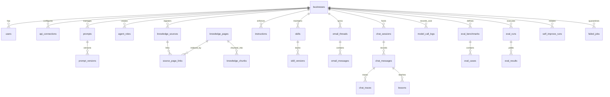

# DATABASE.md — Relational Architecture, Vector Schemas & Multi-Tenant Design

**Application:** AI Tech Consultant (Multi-Tenant SaaS)  
**Database Engine:** PostgreSQL 18 with `pgvector` (>= 0.8.7) & Full-Text Search (`tsvector`, `pg_trgm`)  
**Standard:** Step 1 Architectural Specification (Deliverable)  

---

## 1. Multi-Tenant Isolation Architecture

To ensure strict zero-leakage multi-tenant security:
1. **Mandatory Tenant Foreign Key:** Every tenant-owned table contains a non-nullable `business_id UUID REFERENCES businesses(id) ON DELETE CASCADE`.
2. **Row-Level Security (RLS) & Query Scoping:**
   - At the connection level, `SET LOCAL app.current_tenant_id = '...'` enforces PostgreSQL Row-Level Security policies.
   - At the ORM level (Drizzle), all queries, inserts, updates, and deletes explicitly include `eq(table.businessId, currentTenantId)`.
3. **Compound Tenant Indices:** High-throughput read operations feature composite indexes prefixed with `business_id` (e.g., `(business_id, url)`, `(business_id, health_status)`), ensuring that index scans never touch other tenant data pages in memory.
4. **Atomic Tenant Purge:** Deleting a business record in `businesses` executes a clean, atomic database wipe across all 24 dependent tables via `ON DELETE CASCADE`.

---

## 2. Comprehensive Entity Catalog & Schema Definition

### 2.1 Workspace & Security Entities
- `businesses`:
  - `id` (UUID PK, default `gen_random_uuid()`)
  - `name` (VARCHAR(255) NOT NULL)
  - `slug` (VARCHAR(100) UNIQUE NOT NULL)
  - `readiness_score` (INT DEFAULT 0)
  - `created_at` (TIMESTAMPTZ DEFAULT NOW())
  - `updated_at` (TIMESTAMPTZ DEFAULT NOW())
- `users`:
  - `id` (UUID PK)
  - `business_id` (UUID FK -> `businesses(id) ON DELETE CASCADE`)
  - `email` (VARCHAR(255) NOT NULL)
  - `password_hash` (VARCHAR(255))
  - `role` (VARCHAR(50) NOT NULL DEFAULT 'member') — `owner`, `admin`, `member`
  - `created_at` (TIMESTAMPTZ DEFAULT NOW())
  - *Index:* `UNIQUE (business_id, email)`
- `api_connections`:
  - `id` (UUID PK)
  - `business_id` (UUID FK -> `businesses(id) ON DELETE CASCADE`)
  - `provider` (VARCHAR(50) NOT NULL) — `claude`, `gemini`, `openrouter`, `ollama`, `google`
  - `encrypted_api_key` (TEXT)
  - `endpoint_url` (VARCHAR(255)) — e.g., `http://localhost:11434` for Ollama
  - `status` (VARCHAR(50) DEFAULT 'untested') — `active`, `error`, `untested`
  - `last_tested_at` (TIMESTAMPTZ)
  - *Index:* `UNIQUE (business_id, provider)`

### 2.2 Prompts & Agent Roles Entities
- `prompts`:
  - `id` (UUID PK)
  - `business_id` (UUID FK -> `businesses(id) ON DELETE CASCADE`)
  - `key` (VARCHAR(100) NOT NULL) — `master_system`, `qa_answer`, `write_lesson`, `judge_eval`, `job_tagger`
  - `description` (TEXT)
  - `current_version_id` (UUID)
  - *Index:* `UNIQUE (business_id, key)`
- `prompt_versions`:
  - `id` (UUID PK)
  - `prompt_id` (UUID FK -> `prompts(id) ON DELETE CASCADE`)
  - `business_id` (UUID FK -> `businesses(id) ON DELETE CASCADE`)
  - `version_number` (INT NOT NULL)
  - `template_text` (TEXT NOT NULL)
  - `variables` (JSONB NOT NULL DEFAULT '[]'::jsonb)
  - `change_summary` (TEXT)
  - `created_by` (UUID FK -> `users(id) ON DELETE SET NULL`)
  - `created_at` (TIMESTAMPTZ DEFAULT NOW())
  - *Index:* `UNIQUE (prompt_id, version_number)`
- `agent_roles`:
  - `id` (UUID PK)
  - `business_id` (UUID FK -> `businesses(id) ON DELETE CASCADE`)
  - `name` (VARCHAR(100) NOT NULL)
  - `slug` (VARCHAR(100) NOT NULL) — `support-engineer`, `support-executive`, `ai-consultant`
  - `goal` (TEXT NOT NULL)
  - `tone` (VARCHAR(100) NOT NULL)
  - `system_prompt` (TEXT NOT NULL)
  - `model_id` (VARCHAR(100) NOT NULL DEFAULT 'claude-sonnet-5.5')
  - `allowed_skills` (JSONB DEFAULT '[]'::jsonb)
  - `is_builtin` (BOOLEAN DEFAULT FALSE)
  - `created_at` (TIMESTAMPTZ DEFAULT NOW())
  - *Index:* `UNIQUE (business_id, slug)`

### 2.3 Knowledge Brain Entities
- `knowledge_sources`:
  - `id` (UUID PK)
  - `business_id` (UUID FK -> `businesses(id) ON DELETE CASCADE`)
  - `source_type` (VARCHAR(50) NOT NULL) — `sitemap`, `page_url`, `document`
  - `root_url` (TEXT NOT NULL)
  - `parent_source_id` (UUID FK -> `knowledge_sources(id) ON DELETE CASCADE`) — for nested sitemaps
  - `crawl_schedule` (VARCHAR(50) DEFAULT 'daily') — `daily`, `weekly`, `15_days`, `30_days`
  - `status` (VARCHAR(50) DEFAULT 'pending') — `pending`, `syncing`, `active`, `error`
  - `last_crawled_at` (TIMESTAMPTZ)
- `knowledge_pages`:
  - `id` (UUID PK)
  - `business_id` (UUID FK -> `businesses(id) ON DELETE CASCADE`)
  - `url` (TEXT NOT NULL)
  - `title` (TEXT)
  - `content_hash` (CHAR(64)) — SHA-256 to detect changed content
  - `health_status` (VARCHAR(50) DEFAULT 'active') — `active`, `watch`, `quarantined`, `archived`
  - `consecutive_failures` (INT DEFAULT 0)
  - `http_status` (INT)
  - `redirect_url` (TEXT)
  - `last_checked_at` (TIMESTAMPTZ DEFAULT NOW())
  - `created_at` (TIMESTAMPTZ DEFAULT NOW())
  - *Index:* `UNIQUE (business_id, url)`
  - *Index:* `CREATE INDEX idx_kp_health ON knowledge_pages(business_id, health_status)`
- `source_page_links`:
  - `id` (UUID PK)
  - `business_id` (UUID FK -> `businesses(id) ON DELETE CASCADE`)
  - `source_id` (UUID FK -> `knowledge_sources(id) ON DELETE CASCADE`)
  - `page_id` (UUID FK -> `knowledge_pages(id) ON DELETE CASCADE`)
  - *Index:* `UNIQUE (source_id, page_id)`
- `knowledge_chunks`:
  - `id` (UUID PK)
  - `business_id` (UUID FK -> `businesses(id) ON DELETE CASCADE`)
  - `page_id` (UUID FK -> `knowledge_pages(id) ON DELETE CASCADE`)
  - `chunk_index` (INT NOT NULL)
  - `heading` (TEXT)
  - `content` (TEXT NOT NULL)
  - `image_url` (TEXT)
  - `image_caption` (TEXT)
  - `embedding` (vector(1536)) — pgvector cosine embedding
  - `tsv` (tsvector GENERATED ALWAYS AS (to_tsvector('english', coalesce(heading, '') || ' ' || content || ' ' || coalesce(image_caption, ''))) STORED)
  - *Index:* `CREATE INDEX idx_kc_hnsw ON knowledge_chunks USING hnsw (embedding vector_cosine_ops)`
  - *Index:* `CREATE INDEX idx_kc_tsv ON knowledge_chunks USING gin (tsv)`
  - *Index:* `CREATE INDEX idx_kc_business_page ON knowledge_chunks(business_id, page_id)`
- `instructions`:
  - `id` (UUID PK)
  - `business_id` (UUID FK -> `businesses(id) ON DELETE CASCADE`)
  - `title` (VARCHAR(255) NOT NULL)
  - `rule_text` (TEXT NOT NULL)
  - `applies_to_roles` (JSONB NOT NULL DEFAULT '["all"]'::jsonb)
  - `is_active` (BOOLEAN DEFAULT TRUE)
  - `created_at` (TIMESTAMPTZ DEFAULT NOW())
- `skills`:
  - `id` (UUID PK)
  - `business_id` (UUID FK -> `businesses(id) ON DELETE CASCADE`)
  - `name` (VARCHAR(255) NOT NULL)
  - `slug` (VARCHAR(255) NOT NULL)
  - `description` (TEXT NOT NULL)
  - `trigger_conditions` (TEXT NOT NULL)
  - `steps_markdown` (TEXT NOT NULL)
  - `examples` (JSONB DEFAULT '[]'::jsonb)
  - `current_version_id` (UUID)
  - `created_at` (TIMESTAMPTZ DEFAULT NOW())
  - *Index:* `UNIQUE (business_id, slug)`
- `skill_versions`:
  - `id` (UUID PK)
  - `skill_id` (UUID FK -> `skills(id) ON DELETE CASCADE`)
  - `business_id` (UUID FK -> `businesses(id) ON DELETE CASCADE`)
  - `version_number` (INT NOT NULL)
  - `steps_markdown` (TEXT NOT NULL)
  - `change_notes` (TEXT)
  - `approved_by` (UUID FK -> `users(id) ON DELETE SET NULL`)
  - `created_at` (TIMESTAMPTZ DEFAULT NOW())
  - *Index:* `UNIQUE (skill_id, version_number)`
- `email_threads`:
  - `id` (UUID PK)
  - `business_id` (UUID FK -> `businesses(id) ON DELETE CASCADE`)
  - `gmail_thread_id` (VARCHAR(255) NOT NULL)
  - `subject` (TEXT)
  - `snippet` (TEXT)
  - `notes` (TEXT)
  - `synced_at` (TIMESTAMPTZ DEFAULT NOW())
  - *Index:* `UNIQUE (business_id, gmail_thread_id)`
- `email_messages`:
  - `id` (UUID PK)
  - `business_id` (UUID FK -> `businesses(id) ON DELETE CASCADE`)
  - `thread_id` (UUID FK -> `email_threads(id) ON DELETE CASCADE`)
  - `from_address` (VARCHAR(255) NOT NULL)
  - `to_address` (VARCHAR(255) NOT NULL)
  - `body_text` (TEXT NOT NULL)
  - `notes` (TEXT)
  - `sent_at` (TIMESTAMPTZ NOT NULL)

### 2.4 Chat, Tracing & Teaching Entities
- `chat_sessions`:
  - `id` (UUID PK)
  - `business_id` (UUID FK -> `businesses(id) ON DELETE CASCADE`)
  - `user_id` (UUID FK -> `users(id) ON DELETE SET NULL`)
  - `role_id` (UUID FK -> `agent_roles(id) ON DELETE SET NULL`)
  - `mode` (VARCHAR(50) DEFAULT 'ask') — `ask`, `teach`
  - `title` (VARCHAR(255) DEFAULT 'New Consultation')
  - `created_at` (TIMESTAMPTZ DEFAULT NOW())
- `chat_messages`:
  - `id` (UUID PK)
  - `session_id` (UUID FK -> `chat_sessions(id) ON DELETE CASCADE`)
  - `business_id` (UUID FK -> `businesses(id) ON DELETE CASCADE`)
  - `sender` (VARCHAR(50) NOT NULL) — `user`, `assistant`, `system`
  - `content` (TEXT NOT NULL)
  - `citations` (JSONB DEFAULT '[]'::jsonb)
  - `is_escalated` (BOOLEAN DEFAULT FALSE)
  - `escalation_reason` (VARCHAR(255))
  - `created_at` (TIMESTAMPTZ DEFAULT NOW())
- `chat_traces`:
  - `id` (UUID PK)
  - `message_id` (UUID FK -> `chat_messages(id) ON DELETE CASCADE`)
  - `business_id` (UUID FK -> `businesses(id) ON DELETE CASCADE`)
  - `model_id` (VARCHAR(100) NOT NULL)
  - `prompt_version_id` (UUID FK -> `prompt_versions(id) ON DELETE SET NULL`)
  - `role_id` (UUID FK -> `agent_roles(id) ON DELETE SET NULL`)
  - `knowledge_used` (JSONB DEFAULT '[]'::jsonb)
  - `skills_used` (JSONB DEFAULT '[]'::jsonb)
  - `input_tokens` (INT NOT NULL)
  - `output_tokens` (INT NOT NULL)
  - `cached_tokens` (INT DEFAULT 0)
  - `duration_ms` (INT NOT NULL)
  - `cost_usd` (NUMERIC(10, 6) NOT NULL)
- `lessons`:
  - `id` (UUID PK)
  - `business_id` (UUID FK -> `businesses(id) ON DELETE CASCADE`)
  - `chat_message_id` (UUID FK -> `chat_messages(id) ON DELETE CASCADE`)
  - `title` (VARCHAR(255) NOT NULL)
  - `category` (VARCHAR(100) NOT NULL)
  - `lesson_markdown` (TEXT NOT NULL)
  - `confidence_score` (NUMERIC(4, 2))
  - `status` (VARCHAR(50) DEFAULT 'pending') — `pending`, `approved`, `rejected`
  - `approved_by` (UUID FK -> `users(id) ON DELETE SET NULL`)
  - `approved_at` (TIMESTAMPTZ)
  - `created_at` (TIMESTAMPTZ DEFAULT NOW())

### 2.5 Telemetry, Evaluation & Self-Improvement Entities
- `model_call_logs`:
  - `id` (UUID PK)
  - `business_id` (UUID FK -> `businesses(id) ON DELETE CASCADE`)
  - `task_type` (VARCHAR(100) NOT NULL) — `tag_job`, `find_facts`, `write_reply`, `read_screenshot`, `improve_skill`, `judge_eval`, `self_improve`
  - `model_id` (VARCHAR(100) NOT NULL)
  - `prompt_version_id` (UUID FK -> `prompt_versions(id) ON DELETE SET NULL`)
  - `role_id` (UUID FK -> `agent_roles(id) ON DELETE SET NULL`)
  - `input_tokens` (INT NOT NULL)
  - `output_tokens` (INT NOT NULL)
  - `cached_read_tokens` (INT DEFAULT 0)
  - `duration_ms` (INT NOT NULL)
  - `cost_usd` (NUMERIC(10, 6) NOT NULL)
  - `status` (VARCHAR(50) NOT NULL) — `success`, `error`, `fallback_rerouted`
  - `created_at` (TIMESTAMPTZ DEFAULT NOW())
  - *Index:* `CREATE INDEX idx_mcl_telemetry ON model_call_logs(business_id, created_at DESC)`
- `eval_benchmarks`:
  - `id` (UUID PK)
  - `business_id` (UUID FK -> `businesses(id) ON DELETE CASCADE`)
  - `name` (VARCHAR(100) NOT NULL)
  - `version` (INT NOT NULL DEFAULT 1)
  - `is_active` (BOOLEAN DEFAULT TRUE)
  - `created_at` (TIMESTAMPTZ DEFAULT NOW())
- `eval_cases`:
  - `id` (UUID PK)
  - `benchmark_id` (UUID FK -> `eval_benchmarks(id) ON DELETE CASCADE`)
  - `business_id` (UUID FK -> `businesses(id) ON DELETE CASCADE`)
  - `category` (VARCHAR(100) NOT NULL) — `screenshot`, `unanswerable`, `instruction_skill`, `synonym_typo`, `url_health`, `trick_injection`, `escalation`, `teach_pair`
  - `question` (TEXT NOT NULL)
  - `expected_answer` (TEXT NOT NULL)
  - `expected_source` (TEXT)
  - `expected_action` (VARCHAR(100) DEFAULT 'answer')
  - `created_at` (TIMESTAMPTZ DEFAULT NOW())
- `eval_runs`:
  - `id` (UUID PK)
  - `business_id` (UUID FK -> `businesses(id) ON DELETE CASCADE`)
  - `benchmark_id` (UUID FK -> `eval_benchmarks(id) ON DELETE CASCADE`)
  - `model_id` (VARCHAR(100) NOT NULL)
  - `trigger_source` (VARCHAR(50) DEFAULT 'manual') — `manual`, `release_gate`, `self_improve`
  - `pass_rate` (NUMERIC(5, 2))
  - `total_cost_usd` (NUMERIC(10, 6))
  - `avg_latency_ms` (INT)
  - `p95_latency_ms` (INT)
  - `status` (VARCHAR(50) DEFAULT 'running')
  - `created_at` (TIMESTAMPTZ DEFAULT NOW())
- `eval_results`:
  - `id` (UUID PK)
  - `eval_run_id` (UUID FK -> `eval_runs(id) ON DELETE CASCADE`)
  - `business_id` (UUID FK -> `businesses(id) ON DELETE CASCADE`)
  - `case_id` (UUID FK -> `eval_cases(id) ON DELETE CASCADE`)
  - `actual_answer` (TEXT NOT NULL)
  - `judge_score` (NUMERIC(5, 2) NOT NULL)
  - `judge_reason` (TEXT NOT NULL)
  - `human_note` (TEXT)
  - `is_passed` (BOOLEAN NOT NULL)
  - `created_at` (TIMESTAMPTZ DEFAULT NOW())
- `self_improve_runs`:
  - `id` (UUID PK)
  - `business_id` (UUID FK -> `businesses(id) ON DELETE CASCADE`)
  - `failing_cases_summary` (JSONB NOT NULL)
  - `branch_name` (VARCHAR(255) NOT NULL)
  - `rounds_executed` (INT DEFAULT 0)
  - `max_rounds` (INT DEFAULT 5)
  - `cost_accumulated_usd` (NUMERIC(10, 6) DEFAULT 0)
  - `max_budget_usd` (NUMERIC(10, 6) DEFAULT 5.00)
  - `status` (VARCHAR(50) DEFAULT 'running') — `running`, `passed`, `failed_limit`, `merged`, `reverted`
  - `pr_url` (TEXT)
  - `created_at` (TIMESTAMPTZ DEFAULT NOW())
- `failed_jobs`:
  - `id` (UUID PK)
  - `business_id` (UUID FK -> `businesses(id) ON DELETE CASCADE`)
  - `queue_name` (VARCHAR(100) NOT NULL)
  - `payload` (JSONB NOT NULL)
  - `error_stack` (TEXT)
  - `retry_count` (INT DEFAULT 0)
  - `last_attempt_at` (TIMESTAMPTZ DEFAULT NOW())

---

## 3. Feature-to-Table Mapping Matrix

| Feature Module | Primary Tables Used |
|---|---|
| **Feature 1: Workspace & Settings** | `businesses`, `users`, `api_connections`, `prompts`, `prompt_versions`, `agent_roles`, `model_call_logs`, `failed_jobs` |
| **Feature 2: The Knowledge Brain** | `knowledge_sources`, `knowledge_pages`, `source_page_links`, `knowledge_chunks`, `instructions`, `skills`, `skill_versions`, `email_threads`, `email_messages` |
| **Feature 3: Ask & Teach Chat** | `chat_sessions`, `chat_messages`, `chat_traces`, `lessons`, `agent_roles`, `instructions`, `skills` |
| **Feature 4: The Eval Lab** | `eval_benchmarks`, `eval_cases`, `eval_runs`, `eval_results`, `model_call_logs` |
| **Feature 5: Self-Improve Loop** | `self_improve_runs`, `eval_cases`, `eval_results`, `prompt_versions`, `skill_versions` |
| **Feature 6: Go Live in 15 Min** | `businesses`, `knowledge_sources`, `eval_benchmarks`, `eval_runs` |

---

## 4. Entity-Relationship Diagram



---

## 5. Architectural Decisions (Questions D1 to D15)

### D1. Multi-Tenant Partitioning at 1,000 Businesses
- **My Pick:** Business ID column on every table combined with PostgreSQL Row-Level Security (RLS) and indexed foreign keys.
- **Why:** RLS provides ironclad security guarantees while sharing connection pools, table schemas, and shared HNSW vector indices across tenants.
- **Why not the others:** 
  - *One schema per business:* 1,000 businesses = 25,000 tables. Running a migration takes minutes or hours, exhausts PostgreSQL shared buffer memory, and bloats the system catalog (`pg_class`).
  - *One database per business:* Requires dynamic cross-database connection routing, massive operational overhead, and memory starvation at scale.
- **Numbers:** 1,000 businesses querying a unified indexed schema use ~50 connection pool slots with sub-5ms query times.

### D2. Nested Sitemaps Representation
- **My Pick:** Self-referencing `parent_source_id` foreign key in `knowledge_sources` referencing `knowledge_sources(id) ON DELETE CASCADE`.
- **Why:** Enables standard recursive CTE queries (`WITH RECURSIVE sitemap_tree AS ...`) to traverse sitemap hierarchies with strict relational integrity and automatic cascade cleanup.
- **Why not JSON:** Querying or updating individual nested sitemap sync statuses inside JSON arrays is awkward and lacks foreign key guarantees.

### D3. URL Deduplication across Multiple Sitemaps
- **My Pick:** Exactly **one row** in `knowledge_pages` (unique constraint on `(business_id, url)`) and a junction table `source_page_links` (`id`, `business_id`, `source_id`, `page_id`).
- **Why:** Eliminates duplicate page storage, redundant embedding generation, and wasted scraping bandwidth. A page appearing in 3 sitemaps has 1 row in `knowledge_pages` and 3 rows in `source_page_links`.

### D4. URL Health Tracking & Pending Counts Query
- **My Pick:** Both a `health_status` column (`active`, `watch`, `quarantined`, `archived`) and `consecutive_failures` counter on `knowledge_pages`.
- **Pending URLs Query:**
```sql
SELECT health_status, COUNT(*) as url_count
FROM knowledge_pages
WHERE business_id = $1 AND consecutive_failures > 0
GROUP BY health_status;
```

### D5. Change History & Storage Footprint Calculation
- **My Pick:** Store a SHA-256 `content_hash` on `knowledge_pages`. When checking a page, only re-chunk and update embeddings if the hash differs. Keep only changed diffs in an audit table.
- **Space Calculation:** 1,000 pages checked daily for 1 year = 365,000 checks. 
  - If naive full storage: 1,000 pages * 50 KB * 365 = 18.25 GB.
  - With hash comparison (assuming 2% change rate/month): 1,000 base pages * 50 KB = 50 MB + (1,000 * 0.02 * 12 updates * 50 KB) = 12 MB. **Total storage: ~62 MB (over 99.6% storage savings).**

### D6. Chunking Size, Overlap & Image Placement
- **My Pick:** Semantic markdown heading splitting with a hard ceiling of 500 tokens and 50 tokens overlap.
- **Image Description:** Images/screenshots found in an article are parsed via vision models (Gemini 3.8 Flash / Nemotron Super VL). The extracted description/OCR is embedded directly into the chunk containing that image tag, tagged with `image_url` and `image_caption` columns for instant multimodal retrieval.

### D7. Vector Dimensions, Index Type & Model Migration
- **My Pick:** `vector(1536)` (or `vector(768)`) with an **HNSW** index (`vector_cosine_ops`, `m = 16`, `ef_construction = 64`).
- **Why HNSW over IVFFlat:** HNSW requires no initial clustering training step, provides >95% recall immediately, and handles incremental real-time inserts cleanly.
- **Embedding Model Migration:** When changing models, a background `pg-boss` worker generates new embeddings into a shadow column (`embedding_v2`), verifies benchmark retrieval quality, and swaps columns atomically.

### D8. Hybrid Search Strategy: Full-Text + Vectors
- **My Pick:** Combined PostgreSQL Full-Text Search (`tsvector` + English stemming) and `pgvector` Cosine Similarity, fused using **Reciprocal Rank Fusion (RRF)**:
  $$\text{Score}(d) = \frac{1}{60 + \text{Rank}_{\text{dense}}(d)} + \frac{1}{60 + \text{Rank}_{\text{sparse}}(d)}$$
- Words with typos or morphological variants (e.g., "custom" vs. "customize") match via English dictionary stemming and `pg_trgm` fuzzy similarity.

### D9. Past Gmail Storage & Annotations
- **My Pick:** Store sanitized message bodies in `email_messages` with an indexed `gmail_thread_id`. Do not refetch on every query.
- **Annotations:** Thread-level critique notes reside in `email_threads.notes`; message-specific notes reside in `email_messages.notes`.
- **Attachments:** PDFs and text attachments are parsed into markdown text chunks; large binary assets are kept as external URLs.

### D10. Teaching Linkage: Chat to Lesson to Skill
- `chat_messages` links to `lessons` via `lessons.chat_message_id`.
- If a lesson applies broadly across a workflow, it links to `skills` via `skill_versions.change_notes`, referencing the origin `lesson.id`.
- The user can click any lesson or skill version and trace back to the exact chat session and message that triggered it.

### D11. Chat Session Context & Knowledge Tracking
- `chat_sessions` records `role_id` and `mode` (`ask` or `teach`).
- `chat_traces` records JSON arrays of chunk IDs (`knowledge_used`), skill IDs (`skills_used`), and instruction IDs utilized during that exact turn.

### D12. Skill Versioning & Role Scoping for Instructions
- `skill_versions` stores historical markdown snapshots with `version_number` and `change_notes`.
- `instructions` contains an `applies_to_roles` JSONB array (e.g., `["all"]` or `["support-engineer", "ai-consultant"]`), dynamically queried during prompt assembly.

### D13. Model Call Telemetry Logging
- Logged in `model_call_logs`: `model_id`, `task_type`, `prompt_version_id`, `role_id`, `input_tokens`, `output_tokens`, `cached_read_tokens`, `duration_ms`, `cost_usd`, and `business_id`.

### D14. Account Deletion Cascade Protocol
- Executing `DELETE FROM businesses WHERE id = $1` automatically purges all records in:
  `users`, `api_connections`, `prompts`, `prompt_versions`, `agent_roles`, `knowledge_sources`, `source_page_links`, `knowledge_pages`, `knowledge_chunks`, `instructions`, `skills`, `skill_versions`, `email_threads`, `email_messages`, `chat_sessions`, `chat_messages`, `chat_traces`, `lessons`, `model_call_logs`, `eval_benchmarks`, `eval_cases`, `eval_runs`, `eval_results`, `self_improve_runs`, and `failed_jobs`.
- Disk/blob cleanup hooks remove any cached screenshot images from the file store.

### D15. Prompts, Roles & Dynamic Answer Traceability
- `prompt_versions` tracks every template change. `agent_roles` stores the role configuration.
- Every chat message links to a `chat_traces` record containing `prompt_version_id` and `role_id`, guaranteeing full backward auditability for every single generated token.

---

## 6. First Migration File (`0000_init.sql`)

```sql
-- Enable necessary PostgreSQL extensions
CREATE EXTENSION IF NOT EXISTS "uuid-ossp";
CREATE EXTENSION IF NOT EXISTS "vector";
CREATE EXTENSION IF NOT EXISTS "pg_trgm";

-- 1. Businesses Table
CREATE TABLE businesses (
    id UUID PRIMARY KEY DEFAULT gen_random_uuid(),
    name VARCHAR(255) NOT NULL,
    slug VARCHAR(100) UNIQUE NOT NULL,
    readiness_score INT DEFAULT 0,
    created_at TIMESTAMPTZ DEFAULT NOW(),
    updated_at TIMESTAMPTZ DEFAULT NOW()
);

-- 2. Users Table
CREATE TABLE users (
    id UUID PRIMARY KEY DEFAULT gen_random_uuid(),
    business_id UUID NOT NULL REFERENCES businesses(id) ON DELETE CASCADE,
    email VARCHAR(255) NOT NULL,
    password_hash VARCHAR(255),
    role VARCHAR(50) NOT NULL DEFAULT 'member',
    created_at TIMESTAMPTZ DEFAULT NOW(),
    CONSTRAINT uq_users_business_email UNIQUE (business_id, email)
);

-- 3. API Connections Vault
CREATE TABLE api_connections (
    id UUID PRIMARY KEY DEFAULT gen_random_uuid(),
    business_id UUID NOT NULL REFERENCES businesses(id) ON DELETE CASCADE,
    provider VARCHAR(50) NOT NULL,
    encrypted_api_key TEXT,
    endpoint_url VARCHAR(255),
    status VARCHAR(50) DEFAULT 'untested',
    last_tested_at TIMESTAMPTZ,
    CONSTRAINT uq_api_conn_business_provider UNIQUE (business_id, provider)
);

-- 4. Prompts & Prompt Versions
CREATE TABLE prompts (
    id UUID PRIMARY KEY DEFAULT gen_random_uuid(),
    business_id UUID NOT NULL REFERENCES businesses(id) ON DELETE CASCADE,
    key VARCHAR(100) NOT NULL,
    description TEXT,
    current_version_id UUID,
    CONSTRAINT uq_prompts_business_key UNIQUE (business_id, key)
);

CREATE TABLE prompt_versions (
    id UUID PRIMARY KEY DEFAULT gen_random_uuid(),
    prompt_id UUID NOT NULL REFERENCES prompts(id) ON DELETE CASCADE,
    business_id UUID NOT NULL REFERENCES businesses(id) ON DELETE CASCADE,
    version_number INT NOT NULL,
    template_text TEXT NOT NULL,
    variables JSONB NOT NULL DEFAULT '[]'::jsonb,
    change_summary TEXT,
    created_by UUID REFERENCES users(id) ON DELETE SET NULL,
    created_at TIMESTAMPTZ DEFAULT NOW(),
    CONSTRAINT uq_prompt_versions_num UNIQUE (prompt_id, version_number)
);

-- 5. Agent Roles
CREATE TABLE agent_roles (
    id UUID PRIMARY KEY DEFAULT gen_random_uuid(),
    business_id UUID NOT NULL REFERENCES businesses(id) ON DELETE CASCADE,
    name VARCHAR(100) NOT NULL,
    slug VARCHAR(100) NOT NULL,
    goal TEXT NOT NULL,
    tone VARCHAR(100) NOT NULL,
    system_prompt TEXT NOT NULL,
    model_id VARCHAR(100) NOT NULL DEFAULT 'claude-sonnet-5.5',
    allowed_skills JSONB DEFAULT '[]'::jsonb,
    is_builtin BOOLEAN DEFAULT FALSE,
    created_at TIMESTAMPTZ DEFAULT NOW(),
    CONSTRAINT uq_agent_roles_business_slug UNIQUE (business_id, slug)
);

-- 6. Knowledge Sources & Pages
CREATE TABLE knowledge_sources (
    id UUID PRIMARY KEY DEFAULT gen_random_uuid(),
    business_id UUID NOT NULL REFERENCES businesses(id) ON DELETE CASCADE,
    source_type VARCHAR(50) NOT NULL,
    root_url TEXT NOT NULL,
    parent_source_id UUID REFERENCES knowledge_sources(id) ON DELETE CASCADE,
    crawl_schedule VARCHAR(50) DEFAULT 'daily',
    status VARCHAR(50) DEFAULT 'pending',
    last_crawled_at TIMESTAMPTZ
);

CREATE TABLE knowledge_pages (
    id UUID PRIMARY KEY DEFAULT gen_random_uuid(),
    business_id UUID NOT NULL REFERENCES businesses(id) ON DELETE CASCADE,
    url TEXT NOT NULL,
    title TEXT,
    content_hash CHAR(64),
    health_status VARCHAR(50) DEFAULT 'active',
    consecutive_failures INT DEFAULT 0,
    http_status INT,
    redirect_url TEXT,
    last_checked_at TIMESTAMPTZ DEFAULT NOW(),
    created_at TIMESTAMPTZ DEFAULT NOW(),
    CONSTRAINT uq_knowledge_pages_business_url UNIQUE (business_id, url)
);
CREATE INDEX idx_kp_health ON knowledge_pages(business_id, health_status);

CREATE TABLE source_page_links (
    id UUID PRIMARY KEY DEFAULT gen_random_uuid(),
    business_id UUID NOT NULL REFERENCES businesses(id) ON DELETE CASCADE,
    source_id UUID NOT NULL REFERENCES knowledge_sources(id) ON DELETE CASCADE,
    page_id UUID NOT NULL REFERENCES knowledge_pages(id) ON DELETE CASCADE,
    CONSTRAINT uq_source_page_links UNIQUE (source_id, page_id)
);

-- 7. Knowledge Chunks with pgvector & Full-Text Search
CREATE TABLE knowledge_chunks (
    id UUID PRIMARY KEY DEFAULT gen_random_uuid(),
    business_id UUID NOT NULL REFERENCES businesses(id) ON DELETE CASCADE,
    page_id UUID NOT NULL REFERENCES knowledge_pages(id) ON DELETE CASCADE,
    chunk_index INT NOT NULL,
    heading TEXT,
    content TEXT NOT NULL,
    image_url TEXT,
    image_caption TEXT,
    embedding vector(1536),
    tsv tsvector GENERATED ALWAYS AS (to_tsvector('english', coalesce(heading, '') || ' ' || content || ' ' || coalesce(image_caption, ''))) STORED
);
CREATE INDEX idx_kc_hnsw ON knowledge_chunks USING hnsw (embedding vector_cosine_ops);
CREATE INDEX idx_kc_tsv ON knowledge_chunks USING gin (tsv);
CREATE INDEX idx_kc_business_page ON knowledge_chunks(business_id, page_id);

-- 8. Instructions & Skills
CREATE TABLE instructions (
    id UUID PRIMARY KEY DEFAULT gen_random_uuid(),
    business_id UUID NOT NULL REFERENCES businesses(id) ON DELETE CASCADE,
    title VARCHAR(255) NOT NULL,
    rule_text TEXT NOT NULL,
    applies_to_roles JSONB NOT NULL DEFAULT '["all"]'::jsonb,
    is_active BOOLEAN DEFAULT TRUE,
    created_at TIMESTAMPTZ DEFAULT NOW()
);

CREATE TABLE skills (
    id UUID PRIMARY KEY DEFAULT gen_random_uuid(),
    business_id UUID NOT NULL REFERENCES businesses(id) ON DELETE CASCADE,
    name VARCHAR(255) NOT NULL,
    slug VARCHAR(255) NOT NULL,
    description TEXT NOT NULL,
    trigger_conditions TEXT NOT NULL,
    steps_markdown TEXT NOT NULL,
    examples JSONB DEFAULT '[]'::jsonb,
    current_version_id UUID,
    created_at TIMESTAMPTZ DEFAULT NOW(),
    CONSTRAINT uq_skills_business_slug UNIQUE (business_id, slug)
);

CREATE TABLE skill_versions (
    id UUID PRIMARY KEY DEFAULT gen_random_uuid(),
    skill_id UUID NOT NULL REFERENCES skills(id) ON DELETE CASCADE,
    business_id UUID NOT NULL REFERENCES businesses(id) ON DELETE CASCADE,
    version_number INT NOT NULL,
    steps_markdown TEXT NOT NULL,
    change_notes TEXT,
    approved_by UUID REFERENCES users(id) ON DELETE SET NULL,
    created_at TIMESTAMPTZ DEFAULT NOW(),
    CONSTRAINT uq_skill_versions_num UNIQUE (skill_id, version_number)
);

-- 9. Email Threads & Messages
CREATE TABLE email_threads (
    id UUID PRIMARY KEY DEFAULT gen_random_uuid(),
    business_id UUID NOT NULL REFERENCES businesses(id) ON DELETE CASCADE,
    gmail_thread_id VARCHAR(255) NOT NULL,
    subject TEXT,
    snippet TEXT,
    notes TEXT,
    synced_at TIMESTAMPTZ DEFAULT NOW(),
    CONSTRAINT uq_email_threads_gmail UNIQUE (business_id, gmail_thread_id)
);

CREATE TABLE email_messages (
    id UUID PRIMARY KEY DEFAULT gen_random_uuid(),
    business_id UUID NOT NULL REFERENCES businesses(id) ON DELETE CASCADE,
    thread_id UUID NOT NULL REFERENCES email_threads(id) ON DELETE CASCADE,
    from_address VARCHAR(255) NOT NULL,
    to_address VARCHAR(255) NOT NULL,
    body_text TEXT NOT NULL,
    notes TEXT,
    sent_at TIMESTAMPTZ NOT NULL
);

-- 10. Chat Sessions, Messages & Traces
CREATE TABLE chat_sessions (
    id UUID PRIMARY KEY DEFAULT gen_random_uuid(),
    business_id UUID NOT NULL REFERENCES businesses(id) ON DELETE CASCADE,
    user_id UUID REFERENCES users(id) ON DELETE SET NULL,
    role_id UUID REFERENCES agent_roles(id) ON DELETE SET NULL,
    mode VARCHAR(50) DEFAULT 'ask',
    title VARCHAR(255) DEFAULT 'New Consultation',
    created_at TIMESTAMPTZ DEFAULT NOW()
);

CREATE TABLE chat_messages (
    id UUID PRIMARY KEY DEFAULT gen_random_uuid(),
    session_id UUID NOT NULL REFERENCES chat_sessions(id) ON DELETE CASCADE,
    business_id UUID NOT NULL REFERENCES businesses(id) ON DELETE CASCADE,
    sender VARCHAR(50) NOT NULL,
    content TEXT NOT NULL,
    citations JSONB DEFAULT '[]'::jsonb,
    is_escalated BOOLEAN DEFAULT FALSE,
    escalation_reason VARCHAR(255),
    created_at TIMESTAMPTZ DEFAULT NOW()
);

CREATE TABLE chat_traces (
    id UUID PRIMARY KEY DEFAULT gen_random_uuid(),
    message_id UUID NOT NULL REFERENCES chat_messages(id) ON DELETE CASCADE,
    business_id UUID NOT NULL REFERENCES businesses(id) ON DELETE CASCADE,
    model_id VARCHAR(100) NOT NULL,
    prompt_version_id UUID REFERENCES prompt_versions(id) ON DELETE SET NULL,
    role_id UUID REFERENCES agent_roles(id) ON DELETE SET NULL,
    knowledge_used JSONB DEFAULT '[]'::jsonb,
    skills_used JSONB DEFAULT '[]'::jsonb,
    input_tokens INT NOT NULL,
    output_tokens INT NOT NULL,
    cached_tokens INT DEFAULT 0,
    duration_ms INT NOT NULL,
    cost_usd NUMERIC(10, 6) NOT NULL
);

CREATE TABLE lessons (
    id UUID PRIMARY KEY DEFAULT gen_random_uuid(),
    business_id UUID NOT NULL REFERENCES businesses(id) ON DELETE CASCADE,
    chat_message_id UUID NOT NULL REFERENCES chat_messages(id) ON DELETE CASCADE,
    title VARCHAR(255) NOT NULL,
    category VARCHAR(100) NOT NULL,
    lesson_markdown TEXT NOT NULL,
    confidence_score NUMERIC(4, 2),
    status VARCHAR(50) DEFAULT 'pending',
    approved_by UUID REFERENCES users(id) ON DELETE SET NULL,
    approved_at TIMESTAMPTZ,
    created_at TIMESTAMPTZ DEFAULT NOW()
);

-- 11. Model Call Telemetry Logs
CREATE TABLE model_call_logs (
    id UUID PRIMARY KEY DEFAULT gen_random_uuid(),
    business_id UUID NOT NULL REFERENCES businesses(id) ON DELETE CASCADE,
    task_type VARCHAR(100) NOT NULL,
    model_id VARCHAR(100) NOT NULL,
    prompt_version_id UUID REFERENCES prompt_versions(id) ON DELETE SET NULL,
    role_id UUID REFERENCES agent_roles(id) ON DELETE SET NULL,
    input_tokens INT NOT NULL,
    output_tokens INT NOT NULL,
    cached_read_tokens INT DEFAULT 0,
    duration_ms INT NOT NULL,
    cost_usd NUMERIC(10, 6) NOT NULL,
    status VARCHAR(50) NOT NULL,
    created_at TIMESTAMPTZ DEFAULT NOW()
);
CREATE INDEX idx_mcl_telemetry ON model_call_logs(business_id, created_at DESC);

-- 12. Benchmark & Evaluation
CREATE TABLE eval_benchmarks (
    id UUID PRIMARY KEY DEFAULT gen_random_uuid(),
    business_id UUID NOT NULL REFERENCES businesses(id) ON DELETE CASCADE,
    name VARCHAR(100) NOT NULL,
    version INT NOT NULL DEFAULT 1,
    is_active BOOLEAN DEFAULT TRUE,
    created_at TIMESTAMPTZ DEFAULT NOW()
);

CREATE TABLE eval_cases (
    id UUID PRIMARY KEY DEFAULT gen_random_uuid(),
    benchmark_id UUID NOT NULL REFERENCES eval_benchmarks(id) ON DELETE CASCADE,
    business_id UUID NOT NULL REFERENCES businesses(id) ON DELETE CASCADE,
    category VARCHAR(100) NOT NULL,
    question TEXT NOT NULL,
    expected_answer TEXT NOT NULL,
    expected_source TEXT,
    expected_action VARCHAR(100) DEFAULT 'answer',
    created_at TIMESTAMPTZ DEFAULT NOW()
);

CREATE TABLE eval_runs (
    id UUID PRIMARY KEY DEFAULT gen_random_uuid(),
    business_id UUID NOT NULL REFERENCES businesses(id) ON DELETE CASCADE,
    benchmark_id UUID NOT NULL REFERENCES eval_benchmarks(id) ON DELETE CASCADE,
    model_id VARCHAR(100) NOT NULL,
    trigger_source VARCHAR(50) DEFAULT 'manual',
    pass_rate NUMERIC(5, 2),
    total_cost_usd NUMERIC(10, 6),
    avg_latency_ms INT,
    p95_latency_ms INT,
    status VARCHAR(50) DEFAULT 'running',
    created_at TIMESTAMPTZ DEFAULT NOW()
);

CREATE TABLE eval_results (
    id UUID PRIMARY KEY DEFAULT gen_random_uuid(),
    eval_run_id UUID NOT NULL REFERENCES eval_runs(id) ON DELETE CASCADE,
    business_id UUID NOT NULL REFERENCES businesses(id) ON DELETE CASCADE,
    case_id UUID NOT NULL REFERENCES eval_cases(id) ON DELETE CASCADE,
    actual_answer TEXT NOT NULL,
    judge_score NUMERIC(5, 2) NOT NULL,
    judge_reason TEXT NOT NULL,
    human_note TEXT,
    is_passed BOOLEAN NOT NULL,
    created_at TIMESTAMPTZ DEFAULT NOW()
);

CREATE TABLE self_improve_runs (
    id UUID PRIMARY KEY DEFAULT gen_random_uuid(),
    business_id UUID NOT NULL REFERENCES businesses(id) ON DELETE CASCADE,
    failing_cases_summary JSONB NOT NULL,
    branch_name VARCHAR(255) NOT NULL,
    rounds_executed INT DEFAULT 0,
    max_rounds INT DEFAULT 5,
    cost_accumulated_usd NUMERIC(10, 6) DEFAULT 0,
    max_budget_usd NUMERIC(10, 6) DEFAULT 5.00,
    status VARCHAR(50) DEFAULT 'running',
    pr_url TEXT,
    created_at TIMESTAMPTZ DEFAULT NOW()
);

CREATE TABLE failed_jobs (
    id UUID PRIMARY KEY DEFAULT gen_random_uuid(),
    business_id UUID NOT NULL REFERENCES businesses(id) ON DELETE CASCADE,
    queue_name VARCHAR(100) NOT NULL,
    payload JSONB NOT NULL,
    error_stack TEXT,
    retry_count INT DEFAULT 0,
    last_attempt_at TIMESTAMPTZ DEFAULT NOW()
);
```
