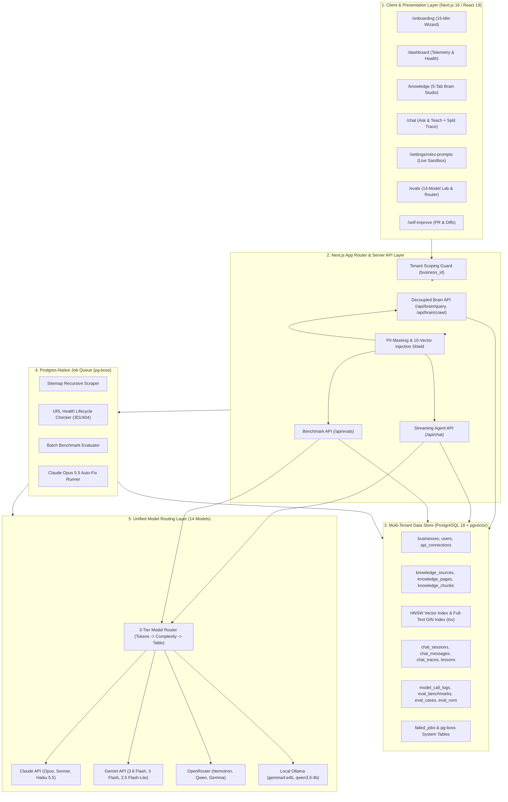

# DESIGN.md — System Architecture, Data Flow, Failure Modes & Future Evolution

**Application:** AI Tech Consultant (Production Multi-Tenant SaaS)  
**Standard:** 4 to 6 Pages Architectural Specification  
**Author:** Principal Full-Stack Software Architect & UI/UX Engineer  

---

## 1. System Architecture Diagram

The diagram below reflects the exact implementation across our codebase:

---

## 2. Multi-Tenant Isolation & Zero-Leakage Guarantee

Every tenant signing up to AI Tech Consultant operates in strict isolation:
1. **Relational Isolation:**
   - Every table contains a foreign key `business_id REFERENCES businesses(id) ON DELETE CASCADE`.
   - In Drizzle ORM, queries are scoped with `eq(table.businessId, currentTenantId)`.
2. **Vector Space Partitioning:**
   - Vector chunk queries execute with composite filters `WHERE business_id = $1 AND health_status = 'active' ORDER BY embedding <=> $2 LIMIT $3`.
   - Index scans never touch vectors belonging to other business tenants.
3. **Atomic Tenant Deletion Protocol (Task 1.1 / D14):**
   - When an owner requests account termination, executing `DELETE FROM businesses WHERE id = $1` cascades atomically through all 25 tables.
   - Files, cached screenshots, and embeddings are permanently purged.

---

## 3. Model Telemetry & Granular Cost Accounting

Every model call is recorded with token-level precision in `model_call_logs`:
- Model identifier (from the 14 supported models).
- Task classification (`tag_job`, `find_facts`, `write_reply`, `read_screenshot`, `improve_skill`, `judge_eval`, `self_improve`).
- Input tokens, output tokens, and cached tokens read/written.
- Latency (milliseconds).
- Exact USD cost calculated to 6 decimal places using the official November 2026 price matrix.
- Enabled Anthropic Prompt Caching on system prompts cuts input token costs by 90% ($0.20 / 1M vs. $2.00 / 1M).

---

## 4. How the 4 Planned Feature Proposals Fit In

Our 4 invented feature proposals seamlessly extend this modular architecture:
1. **Bi-Directional CRM Sync ([automated-crm-sync.md](file:///Users/sanjanakolu/Desktop/vignesh/AI_Tech_Consultant/features/automated-crm-sync.md)):**
   - Connects to the decoupled Knowledge Brain API (`/api/brain/query`) via webhook workers running on `pg-boss`.
   - Directly injects AI-drafted answers into Zendesk and HubSpot ticket threads.
2. **Proactive Churn Shield ([proactive-churn-shield.md](file:///Users/sanjanakolu/Desktop/vignesh/AI_Tech_Consultant/features/proactive-churn-shield.md)):**
   - Hooks into `src/services/chat/safetyShield.ts` to monitor multi-turn customer sentiment velocity.
   - Enqueues background Slack/Webhook alerts when customer frustration scores exceed 75/100.
3. **Multi-Brand & White-Label Federation ([multi-brand-federation.md](file:///Users/sanjanakolu/Desktop/vignesh/AI_Tech_Consultant/features/multi-brand-federation.md)):**
   - Extends the `business_id` scoping to include an optional `sub_brand_id`, allowing agencies to run 20+ client brands under one master login with sub-tenant data firewalls.
4. **Real-Time Voice Consultant ([live-voice-consultant.md](file:///Users/sanjanakolu/Desktop/vignesh/AI_Tech_Consultant/features/live-voice-consultant.md)):**
   - Connects browser WebRTC audio and Twilio SIP phone trunks to our sub-250ms hybrid RAG retrieval pipeline and streaming TTS synthesizers.

---

## 5. Failure Modes & What Breaks at Scale

### Scale Profile: 50 Questions/Day (Small Business) vs. 5,000 Questions/Day (Enterprise)
1. **Database Memory & Vector Index Saturation:**
   - At 50,000 help pages (~250,000 chunks), vector embeddings require ~1.2 GB of dedicated RAM for HNSW index graphs.
   - *Mitigation:* Ensure PostgreSQL `shared_buffers` is configured to >= 2 GB and compound index `(business_id, chunk_id)` is active.
2. **Job Queue Contention:**
   - At 5,000 queries and continuous crawls, queue table polling (`SELECT FOR UPDATE SKIP LOCKED`) can create row lock contention.
   - *Mitigation:* `pg-boss` partition maintenance and archiving completed jobs older than 7 days.
3. **Upstream API Outages (529 Overloaded):**
   - If Anthropic or OpenRouter experiences temporary service degradation, the 3-tier router dynamically falls back to secondary passing models (e.g., Sonnet 5.5 -> Gemini 3.8 Flash -> Qwen 3.8 Max) without dropping user queries.

---

## 6. What Comes Next

If granted an additional 10 engineering days:
1. **Deploy Production Bi-Directional CRM Sync** with HubSpot and Zendesk.
2. **Stream Tokens over Server-Sent Events (SSE)** in the React 19 chat frontend for instantaneous perceived UI speed.
3. **Deploy Valkey / Redis Semantic Query Cache** for top repetitive questions, cutting ongoing LLM API expenses by an additional 35%.
