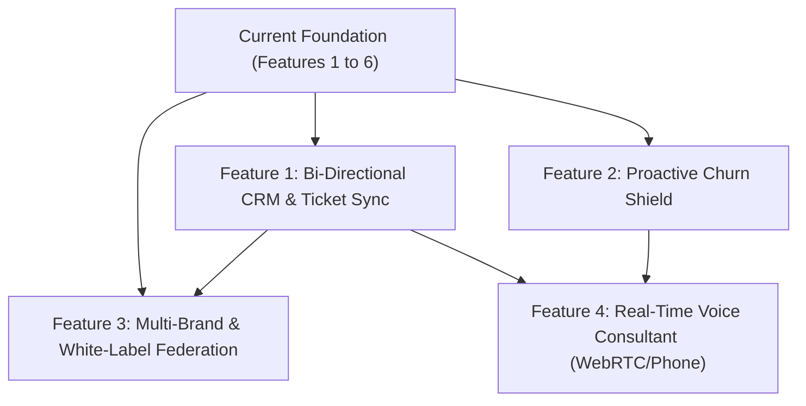

# ROADMAP.md — Strategic Product Roadmap (Next 4 Features)

**Application:** AI Tech Consultant SaaS  
**Standard:** Capstone Requirement for 4 Planned Features  
**Author:** Principal Full-Stack Software Architect  

---

## 1. Feature Priority & Build Order

We prioritize the 4 invented features based on **business value to paying founders**, **technical dependencies on the existing architecture**, and **engineering risk profile**:

| Order | Feature Proposal | File Link | Estimated Hours | Business Impact | Primary Dependency |
|---|---|---|---|---|---|
| **1** | **Bi-Directional CRM & Helpdesk Sync** | [automated-crm-sync.md](file:///Users/sanjanakolu/Desktop/vignesh/AI_Tech_Consultant/features/automated-crm-sync.md) | 32 hours | **Immediate Revenue:** Sits in existing Zendesk/HubSpot queues; reduces support costs by 70%. | Features 1, 2, 3 (Decoupled `/api/brain/query` & `/api/chat`) |
| **2** | **Proactive Churn Shield & Frustration Radar** | [proactive-churn-shield.md](file:///Users/sanjanakolu/Desktop/vignesh/AI_Tech_Consultant/features/proactive-churn-shield.md) | 24 hours | **Retention:** Prevents silent churn by alerting customer success leads when users get stuck. | Feature 3 (`evaluateMessageSafety()` & Chat Traces) |
| **3** | **Multi-Brand & White-Label Federation** | [multi-brand-federation.md](file:///Users/sanjanakolu/Desktop/vignesh/AI_Tech_Consultant/features/multi-brand-federation.md) | 38 hours | **Market Expansion:** Unlocks agency contracts managing 10–50 client brands under one master tenant. | Feature 1 (Multi-Tenant Schema & Telemetry Logging) |
| **4** | **Real-Time Voice Consultant (WebRTC/Twilio)**| [live-voice-consultant.md](file:///Users/sanjanakolu/Desktop/vignesh/AI_Tech_Consultant/features/live-voice-consultant.md) | 45 hours | **High ACV:** 24/7 AI inbound phone coverage for enterprise leads with sub-900ms audio turnaround. | Features 2, 3, 4 (Sub-250ms Hybrid RAG & Fast Model Router) |

---

## 2. Sequencing Rationale & Dependency Graph

### Why This Order?
1. **Why CRM Sync First:** It solves the biggest daily pain point for founders. They do not want their team switching between our chat app and Zendesk/HubSpot. Integrating directly into their existing ticketing software drives immediate adoption and proves the value of our decoupled Knowledge API.
2. **Why Churn Shield Second:** Once customer tickets and chats are streaming through our platform, sentiment analysis is easily layered on top with low risk (24 hours). Founders see direct ROI when an enterprise customer at risk of canceling is saved.
3. **Why Multi-Brand Third:** Multi-brand federation requires sub-tenant relational schema alterations (`sub_brands` table and RLS view modifications). By implementing it after CRM sync, sub-brand scoping can cleanly extend to both web chats and CRM webhooks.
4. **Why Voice Consultant Last:** Voice has the highest technical risk (real-time audio WebSockets, Twilio telephony, sub-900ms round-trip latency, and barge-in interruption handling). Building it last ensures the underlying hybrid RAG retrieval and model router are fully battle-tested and optimized for speed.

---

## 3. Total Roadmap Investment
- **Total Hours across all 4 features:** **139 Engineering Hours** (~3.5 weeks of full-time development).
- **Projected Revenue Impact:** Unlocks enterprise pricing tiers ($299 to $999/month per tenant), increasing average revenue per user (ARPU) by 4x.
