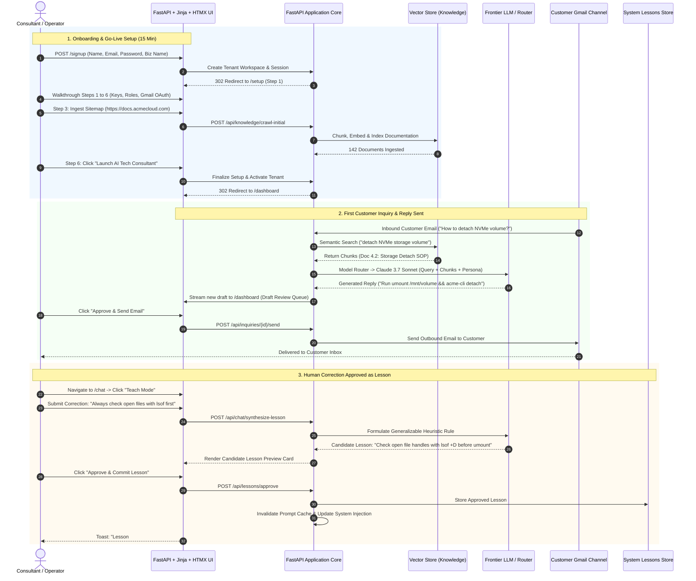

# UX Specifications: AI Tech Consultant Capstone

**Project:** AI Tech Consultant Capstone  
**Target Architecture:** Python 3.14, FastAPI, Jinja2 Server-Side Templates, HTMX 2.x  
**Document Status:** Task 0 Specification (Design & Architecture Baseline — No Application Code)  

---

## 1. System Overview & Screen Inventory

The AI Tech Consultant platform is built with a server-rendered, hypermedia-driven architecture using **FastAPI**, **Jinja2**, and **HTMX**. HTMX drives partial page updates via AJAX requests (`hx-get`, `hx-post`, `hx-put`, `hx-delete`), replacing target DOM elements (`hx-target`, `hx-swap`) without client-side SPA bundle overhead.

The platform consists of nine core screens:

1. **Sign Up (`/signup`)**: Self-service account and initial business registration with instant tenant workspace initialization.
2. **Login (`/login`)**: Session authentication, secure password or SSO access, and session recovery.
3. **Dashboard (`/dashboard`)**: Central executive overview displaying system operational health, active model status, ingestion progress, recent customer interactions, and quick-action shortcuts.
4. **Go Live Setup (15-Minute Wizard) (`/setup`)**: Step-by-step guided onboarding to configure business profile, API keys, initial knowledge ingestion, role persona, live test, and email channel activation.
5. **Knowledge Management (`/knowledge`)**: Multi-tab interface for ingesting, managing, verifying, and archiving multi-source enterprise knowledge (sitemaps, URLs, instructions, skills, emails).
6. **Ask and Teach Chat (`/chat`)**: Dual-mode interactive workspace allowing internal operators to converse with the AI consultant across different personas, inspect citations, and trigger "Teach Mode" to correct answers and create approved system lessons.
7. **Eval Lab (`/eval-lab`)**: Rigorous LLM evaluation harness featuring a 14-model benchmark matrix, side-by-side model outputs, LLM-as-a-judge calibration, and production release gating.
8. **Self-Improve Runs (`/self-improve`)**: Autonomous improvement loop dashboard displaying training/lesson integration runs, prompt/skill diffs, automated evaluation results, human approval controls, and instant rollback.
9. **Settings (`/settings`)**: Vertical-tab control panel for business tenancy, multi-provider LLM credentials and connections, prompt registry with versioning, role editor with live sandbox chat, 3-step model routing fallbacks, and audit/cost logs.

---

## 2. Navigation Architecture & Exact Tab Placements

### 2.1 Global Layout Hierarchy
- **Top Navigation Bar (Persistent)**:
  - Left: Application Logo (`AI Tech Consultant`), Workspace / Business Switcher dropdown.
  - Center: Global Primary Nav Links (`Dashboard`, `Knowledge`, `Ask & Teach`, `Eval Lab`, `Self-Improve`).
  - Right: System Health Indicator (Green/Yellow/Red pulse), Active Model Pill, Setup Checklist Status ("5/6 Steps Complete"), User Avatar & Settings Cog (`/settings`).
- **Sub-Navigation & Tab Conventions**:
  - Horizontal tabs sit flush beneath the screen title bar with bottom border indicators (`border-b-2 border-primary`).
  - Vertical tabs sit in a 240px left-hand sub-navigation rail with active background fills and left indicator accents.
  - Tab state switching is powered by HTMX (`hx-get`, `hx-target="#tab-content"`, `hx-push-url="true"`), ensuring clean URLs, deep linking, and zero full-page reloads.

### 2.2 Exact Tab Placements for Multi-Tab Screens

```
+----------------------------------------------------------------------------------------------------+
| TOP GLOBAL NAVBAR: [Logo: AI Tech Consultant] [Biz Dropdown] | [Dash] [Knowledge] [Chat] [Eval]... |
+----------------------------------------------------------------------------------------------------+

1. KNOWLEDGE SCREEN TAB PLACEMENT: Horizontal Top Tabs below Header
+----------------------------------------------------------------------------------------------------+
| Header: Knowledge Base Management                                 [+ Ingest Knowledge] [Re-Index]  |
| Tabs: [Sitemaps] | [Page URLs] | [Instructions] | [Skills] | [Past Emails] | [Archived View]       |
+----------------------------------------------------------------------------------------------------+
| Content Area (#tab-content): Dynamically swapped via HTMX                                          |
+----------------------------------------------------------------------------------------------------+

2. EVAL LAB SCREEN TAB PLACEMENT: Horizontal Top Tabs below Header
+----------------------------------------------------------------------------------------------------+
| Header: LLM Evaluation & Benchmark Lab                            [Run New Eval] [Export Reports]  |
| Tabs: [14-Model Benchmark] | [Side-by-Side Comparison] | [Judge Calibration] | [Release Gate]      |
+----------------------------------------------------------------------------------------------------+
| Content Area (#tab-content): Dynamically swapped via HTMX                                          |
+----------------------------------------------------------------------------------------------------+

3. SETTINGS SCREEN TAB PLACEMENT: Vertical Left Tabs
+--------------------+-------------------------------------------------------------------------------+
| Header: System Settings & Workspace Configuration                                                  |
+--------------------+-------------------------------------------------------------------------------+
| Vertical Rail      | Active Settings Tab Content Area (#settings-content)                          |
| [ Business       ] |                                                                               |
| [ Keys & Connect ] |                                                                               |
| [ Prompts        ] |                                                                               |
| [ Roles          ] |                                                                               |
| [ Model Routing  ] |                                                                               |
| [ Logs & Cost    ] |                                                                               |
+--------------------+-------------------------------------------------------------------------------+
```

---

## 3. Screen & Tab Deep Dive: Data, Actions, and Button Routing

---

### Screen 1: Sign Up (`/signup`)
- **Data Shown**:
  - Clean card interface with brand logo, product tagline ("Deploy Your Autonomous AI Tech Consultant in 15 Minutes").
  - Form Fields:
    - User Full Name (`text`, required).
    - Work Email Address (`email`, required, real-time MX & format validation via HTMX).
    - Password (`password`, with client/server strength meter: min 10 chars, symbol, number, mixed case).
    - Company / Business Name (`text`, required, auto-populates workspace subdomain/slug).
    - Primary Business Domain / Website URL (`url`, optional, pre-seeded for Go Live setup).
  - Terms of Service and Privacy Policy agreement checkbox.
- **Actions User Can Perform**:
  - Input user credentials and initial company workspace metadata.
  - Trigger inline email availability check on field blur (`hx-post="/api/auth/check-email"`).
  - Submit the registration form.
  - Navigate to Login if an account already exists.
- **Buttons & Routing**:
  | Button Label | Action Type / Method | HTMX Target / Swap | Destination / Effect |
  |---|---|---|---|
  | `Create Account & Workspace` | `POST /signup` | `body` / Redirect | Validates input, creates User + Business tenant in database, sets secure session cookie, redirects to `/setup` (Step 1). |
  | `Sign in with Google` | `GET /auth/google` | Full Window Nav | Initiates Google OAuth2 flow; redirects to `/setup` on success. |
  | `Already have an account? Sign In` | `GET /login` | Full Window Nav | Navigates to `/login`. |

---

### Screen 2: Login (`/login`)
- **Data Shown**:
  - Account sign-in form with security badge.
  - Form Fields: Email Address, Password.
  - "Remember this device for 30 days" checkbox.
  - Notification banner area (`#alert-box`) for invalid credentials, expired sessions, or password reset confirmations.
- **Actions User Can Perform**:
  - Enter credentials and submit.
  - Request password reset.
  - Authenticate via Google OAuth SSO.
- **Buttons & Routing**:
  | Button Label | Action Type / Method | HTMX Target / Swap | Destination / Effect |
  |---|---|---|---|
  | `Sign In` | `POST /login` | `#alert-box` on error / Redirect on success | On failure: renders inline error alert. On success: redirects to `/dashboard` (or `/setup` if onboarding incomplete). |
  | `Sign in with Google` | `GET /auth/google` | Full Window Nav | Initiates Google OAuth2 callback flow. |
  | `Forgot Password?` | `GET /forgot-password` | Full Window Nav | Navigates to password reset dispatch screen. |
  | `Don't have an account? Sign Up` | `GET /signup` | Full Window Nav | Navigates to `/signup`. |

---

### Screen 3: Dashboard (`/dashboard`)
- **Data Shown**:
  - **Quick Stats Bar**:
    - Active Model (`Claude 3.7 Sonnet`, `Gemini 2.5 Flash`, etc.).
    - Ingested Chunks Count (e.g., `14,820 chunks across 64 documents`).
    - Customer Inquiries Handled (24h count + resolution rate %).
    - Pending Human Reviews / Corrections count badge (e.g., `3 pending`).
    - Estimated LLM Monthly Cost & Budget Burn Rate.
  - **Go Live Readiness Widget**:
    - Progress ring showing checklist status (e.g., "83% Ready — Step 6 Pending").
  - **Live Activity Feed (SSE / HTMX Polling)**:
    - Real-time stream of incoming customer emails, auto-generated drafts, confidence scores, and sent replies.
  - **System Health Card**:
    - Latency (p95), Ollama local status (`Connected` / `Offline`), Vector Database status (`Healthy`), Gmail OAuth status (`Syncing`).
  - **Recent Approved Lessons**:
    - Micro-list of recent lessons promoted from chat corrections into master prompt memory.
- **Actions User Can Perform**:
  - Filter activity feed by status: `Drafted`, `Sent`, `Flagged for Review`, `Failed`.
  - Pause / Resume autonomous outbound auto-reply mode.
  - Click on any recent inquiry to open detailed inspection modal.
  - Review pending lessons directly from the dashboard widget.
- **Buttons & Routing**:
  | Button Label | Action Type / Method | HTMX Target / Swap | Destination / Effect |
  |---|---|---|---|
  | `Complete Setup` | `GET /setup` | Full Window Nav | Navigates to the current incomplete step in `/setup`. |
  | `Autonomous Mode: [ON/OFF]` | `POST /api/settings/autonomous-toggle` | `#autonomous-status-badge` / `outerHTML` | Toggles autonomous email dispatch; shows toast notification. |
  | `Review Pending ([N])` | `GET /chat?filter=pending_review` | Full Window Nav | Deep links to `/chat` with review drawer open. |
  | `Add Knowledge` | `GET /knowledge/urls` | Full Window Nav | Navigates to `/knowledge` with URL ingestion modal triggered. |
  | `Run Benchmark` | `GET /eval-lab/benchmark` | Full Window Nav | Navigates to `/eval-lab` benchmark tab. |
  | `View Full Logs` | `GET /settings/logs` | Full Window Nav | Navigates to `/settings` Logs tab. |

---

### Screen 4: Go Live Setup (15-Minute Wizard) (`/setup`)
The 15-minute onboarding wizard is structured into 6 sequential steps with an active step progress indicator along the top:
1. Business Profile
2. Model & API Keys
3. Knowledge Ingestion
4. Role & Persona Configuration
5. Verification & Live Test
6. Email Channel Activation

#### Wizard Steps Detail
- **Step 1: Business Profile**
  - *Data Shown*: Company name, support email address, time zone, industry sector (SaaS, E-commerce, Cloud Hosting, IT Services), business hours.
  - *Actions*: Enter business details, upload company logo.
  - *Buttons*: `Next: API Keys ->` (`POST /api/setup/step1`, target `#wizard-body`, loads Step 2).
- **Step 2: Model & API Keys**
  - *Data Shown*: Card selectors for Anthropic (Claude), Google (Gemini), OpenRouter, and Ollama (default: `http://localhost:11434`). Key masked input fields with status badges (`Unchecked`, `Valid`, `Invalid`).
  - *Actions*: Paste API keys, specify Ollama host URL, run connection tests.
  - *Buttons*:
    - `Test Key` (per provider): `POST /api/keys/test` -> updates badge to green `Verified (142ms)`.
    - `<- Back`: loads Step 1.
    - `Next: Knowledge Ingestion ->`: `POST /api/setup/step2`, loads Step 3.
- **Step 3: Knowledge Ingestion (Initial Crawl)**
  - *Data Shown*: Primary documentation URL / Sitemap input field; drag-and-drop box for FAQs/PDFs/Markdown guidelines; live progress log terminal (`Discovered 24 URLs... Parsing... Embedding...`).
  - *Actions*: Enter public docs URL or sitemap; upload files; watch real-time indexing progress bar.
  - *Buttons*:
    - `Start Crawl`: `POST /api/knowledge/crawl-initial` -> streams progress via HTMX SSE into `#crawl-terminal`.
    - `Skip for Now`: advances without data.
    - `Next: Role Config ->`: `POST /api/setup/step3`, loads Step 4.
- **Step 4: Role & Persona Configuration**
  - *Data Shown*: Three selectable pre-configured archetype cards:
    1. *Support Engineer* (Technical, code-aware, documentation-grounded, troubleshooting steps).
    2. *Support Executive* (Professional, concise, billing/account SLA oriented, empathetic).
    3. *AI Consultant* (Architectural advice, best practices, strategic implementation).
    - Slider for response tone: `Formal <---> Conversational`.
    - Guardrail strictness toggles: `Never hallucinate beyond docs`, `Escalate on billing disputes`.
  - *Actions*: Select active primary role, adjust tone and guardrails.
  - *Buttons*: `Next: Test AI ->` (`POST /api/setup/step4`, loads Step 5).
- **Step 5: Verification & Live Test**
  - *Data Shown*: Split-screen test interface. Left: simulated incoming customer ticket ("How do I rotate our API keys without downtime?"). Right: AI response generated using ingested knowledge + citations + confidence gauge (e.g., `94%`).
  - *Actions*: Type custom question or click sample prompt; inspect citation sources.
  - *Buttons*:
    - `Regenerate Answer`: re-runs query against configured model.
    - `Confirm & Proceed`: `POST /api/setup/step5`, loads Step 6.
- **Step 6: Email Channel Activation**
  - *Data Shown*: Gmail OAuth 2.0 connection card; Inbound forwarding address option (`support-ai@tenant.domain.com`); Safety sandbox selector (`Drafts Only [Safe Mode]` vs. `Autonomous Send [Live]`).
  - *Actions*: Connect Gmail via OAuth; toggle Safe Mode.
  - *Buttons*:
    - `Connect Gmail`: initiates OAuth popup.
    - `Launch AI Tech Consultant (Go Live!)`: `POST /api/setup/finalize` -> updates business status to `active`, redirects to `/dashboard` with celebration banner.

---

### Screen 5: Knowledge Management (`/knowledge`)
Multi-tab interface. **Placement**: Horizontal top tabs directly below the page header.

#### Global Knowledge Header
- **Data Shown**: Total chunk count, storage utilization, last full re-index timestamp, vector index health badge.
- **Global Actions**: Search knowledge chunks by keyword/semantic similarity (`hx-post="/api/knowledge/search"`).
- **Buttons**:
  - `+ Ingest Knowledge`: opens universal ingestion modal drawer (`#ingest-modal`).
  - `Re-Index Entire Base`: `POST /api/knowledge/reindex` (displays confirmation modal before execution).

---

#### Tab 5.1: Sitemaps (`/knowledge/sitemaps`)
- **Data Shown**:
  - Table of registered sitemaps:
    - Columns: Sitemap URL, Frequency (Daily, Weekly, Manual), Total URLs Discovered, Total Chunks Embedded, Last Crawled Date, Status Badge (`Success`, `Crawling 45%`, `Failed`).
- **Actions User Can Perform**:
  - Register new sitemap URL.
  - Change crawl schedule frequency.
  - Trigger immediate manual re-crawl.
  - Delete or archive a sitemap.
- **Buttons & Routing**:
  | Button Label | Action Type / Method | HTMX Target / Swap | Destination / Effect |
  |---|---|---|---|
  | `+ Add Sitemap` | `GET /knowledge/sitemaps/new` | `#modal-container` / `innerHTML` | Opens modal with URL input and crawl depth selector. |
  | `Crawl Now` | `POST /knowledge/sitemaps/{id}/crawl` | `#row-{id}` / `outerHTML` | Starts background crawler task; swaps row with live spinner. |
  | `View Discovered URLs` | `GET /knowledge/sitemaps/{id}/urls` | `#tab-content` / `innerHTML` | Navigates to Page URLs tab filtered by this sitemap. |
  | `Archive` | `POST /knowledge/sitemaps/{id}/archive` | `#row-{id}` / `outerHTML` | Moves sitemap to Archived View. |

---

#### Tab 5.2: Page URLs (`/knowledge/urls`)
- **Data Shown**:
  - Filterable, searchable datatable of individual webpage URLs:
    - Columns: Page Title, Target URL, HTTP Status (200, 301, 404), Chunk Count, Content Hash / ETag, Ingest Date, Actions.
  - Filter controls: Status, Sitemap Origin, Date Range.
- **Actions User Can Perform**:
  - Add individual standalone URL for one-off crawling.
  - Bulk select URLs for re-crawling or deletion.
  - Inspect extracted markdown content preview and chunk breakdown.
- **Buttons & Routing**:
  | Button Label | Action Type / Method | HTMX Target / Swap | Destination / Effect |
  |---|---|---|---|
  | `+ Add URL` | `GET /knowledge/urls/new` | `#modal-container` / `innerHTML` | Opens single URL ingestion dialog. |
  | `Inspect Chunks` | `GET /knowledge/urls/{id}/chunks` | `#side-drawer` / `innerHTML` | Opens right drawer showing chunk text, tokens, and embeddings. |
  | `Re-Scrape` | `POST /knowledge/urls/{id}/rescrape` | `#row-{id}` / `outerHTML` | Re-fetches web page, diffs content, updates vectors. |
  | `Delete` | `DELETE /knowledge/urls/{id}` | `#row-{id}` / `delete` | Deletes URL and purges associated vector chunks. |

---

#### Tab 5.3: Instructions (`/knowledge/instructions`)
- **Data Shown**:
  - List of procedural guidelines, SOPs, and operational constraints uploaded by team admins (e.g., "Refund Policy SOP", "Escalation to Tier 2 Engineering", "Prohibited Technical Advice").
  - Card view showing: Title, Priority Order (P0 Critical, P1 Standard), Target Role applicability, Last Updated By, Character Count.
- **Actions User Can Perform**:
  - Create new plain text / Markdown instruction rule.
  - Edit existing instruction text with live token counter.
  - Toggle instruction active/inactive switch.
  - Drag-and-drop to re-order instruction execution precedence.
- **Buttons & Routing**:
  | Button Label | Action Type / Method | HTMX Target / Swap | Destination / Effect |
  |---|---|---|---|
  | `+ New Instruction` | `GET /knowledge/instructions/new` | `#instruction-editor` / `innerHTML` | Opens full Markdown editor. |
  | `Save Instruction` | `POST /knowledge/instructions` | `#instructions-list` / `innerHTML` | Saves instruction, recompiles system instruction cache. |
  | `Toggle Active` | `POST /knowledge/instructions/{id}/toggle` | `#instruction-{id}` / `outerHTML` | Enables/disables instruction without deletion. |
  | `Delete` | `DELETE /knowledge/instructions/{id}` | `#instruction-{id}` / `delete` | Permanently removes instruction. |

---

#### Tab 5.4: Skills (`/knowledge/skills`)
- **Data Shown**:
  - Catalog of actionable tools and structured capabilities the AI can invoke (e.g., `QueryOrderDatabase`, `CheckServiceHealth`, `CalculatePricingDiscount`, `SearchGitIssues`).
  - Cards showing: Skill Name, Python/Function signature, Authentication dependency, Enabled Roles, Status (`Active`, `Draft`, `Needs Credentials`).
- **Actions User Can Perform**:
  - Register new OpenAPI / Python tool schema.
  - Test skill execution in isolation with mock parameters.
  - Enable/disable skill per business role.
- **Buttons & Routing**:
  | Button Label | Action Type / Method | HTMX Target / Swap | Destination / Effect |
  |---|---|---|---|
  | `+ Create Skill` | `GET /knowledge/skills/new` | `#modal-container` / `innerHTML` | Opens schema builder modal (name, docstring, parameters JSON). |
  | `Test Run` | `POST /knowledge/skills/{id}/test` | `#test-output-{id}` / `innerHTML` | Executes tool against sandbox environment and displays JSON result. |
  | `Save Skill` | `POST /knowledge/skills` | `#skills-catalog` / `innerHTML` | Commits skill definition to database. |

---

#### Tab 5.5: Past Emails (`/knowledge/emails`)
- **Data Shown**:
  - Archive of past customer support email threads ingested as high-value few-shot context:
    - Columns: Customer Subject, Customer Inquiry Preview, Approved Agent Reply, Ingestion Source (Gmail, CSV, Zendesk export), Tokens, Created At.
  - Search bar with filter by resolved date and customer sentiment.
- **Actions User Can Perform**:
  - Trigger one-time Gmail historical sync (last 90 days of resolved threads).
  - Upload CSV/JSON export of past support tickets.
  - Edit ground-truth reply text to sanitize sensitive PII before embedding.
  - Delete outdated email examples.
- **Buttons & Routing**:
  | Button Label | Action Type / Method | HTMX Target / Swap | Destination / Effect |
  |---|---|---|---|
  | `Sync Historical Gmail` | `POST /knowledge/emails/sync` | `#sync-progress-banner` / `innerHTML` | Launches background batch ingest job. |
  | `Upload CSV Export` | `GET /knowledge/emails/upload` | `#modal-container` / `innerHTML` | Opens file upload modal dialog. |
  | `Sanitize & Embed` | `POST /knowledge/emails/{id}/embed` | `#row-{id}` / `outerHTML` | Runs PII scrubber (NER) and commits vectors to store. |

---

#### Tab 5.6: Archived Knowledge Base View (`/knowledge/archived`)
- **Data Shown**:
  - Read-only table of decommissioned sitemaps, retired URLs, deprecated instructions, and obsolete skills.
  - Metadata: Date Archived, Reason for Archival (Replaced by Version N, URL 404, Admin Deletion), Original Author.
- **Actions User Can Perform**:
  - Search and audit historical knowledge snapshots.
  - Restore archived item back to active knowledge status.
  - Permanently purge items (hard delete).
- **Buttons & Routing**:
  | Button Label | Action Type / Method | HTMX Target / Swap | Destination / Effect |
  |---|---|---|---|
  | `Restore to Active` | `POST /knowledge/archived/{id}/restore` | `#archived-list` / `innerHTML` | Re-indexes item and moves it back to its respective active tab. |
  | `Permanent Purge` | `DELETE /knowledge/archived/{id}/purge` | `#row-{id}` / `delete` | Hard deletes item from database and vector index. |

---

### Screen 6: Ask and Teach Chat (`/chat`)
- **Data Shown**:
  - **Left Sidebar**: Session history list (past internal conversations, test sessions, customer escalation threads); Role Switcher radio pill (`Support Engineer`, `Support Executive`, `AI Consultant`).
  - **Main Chat Pane**:
    - Header: Active Role Persona, Grounded Documents Count, Teach Mode Switch indicator (`Active` / `Standard`).
    - Message Stream: User prompts, AI responses rendered with Markdown, syntax-highlighted code blocks, and expandable Citation Badges (`[1] Docs: API Key Rotation`, `[2] SOP: Escalation`).
    - Confidence Gauge per message (e.g., `Confidence: 96% | Latency: 680ms | Model: Claude 3.7 Sonnet`).
    - Feedback Action Row beneath each AI message: `Helpful (Thumbs Up)`, `Incorrect / Needs Improvement (Thumbs Down)`, `Edit Response / Teach`.
  - **Teach Mode Drawer (Conditional / Right Pane)**:
    - Appears when user clicks `Teach` or `Edit Response`:
    - Shows: Original Question, Bad AI Answer, Human Corrected Answer field (rich text), Extracted Root Cause dropdown (`Missing Knowledge`, `Incorrect Reasoning`, `Wrong Tone`, `Outdated Info`).
    - "Generated Lesson" Preview: A synthesized heuristic rule automatically drafted by LLM (e.g., *"When asked about OAuth token expiry, always specify that refresh tokens expire in 14 days, not 30 days"*).
- **Actions User Can Perform**:
  - Switch between conversation threads.
  - Change active Role persona in real-time.
  - Type prompt into auto-expanding input box (`hx-post="/api/chat/send"`).
  - Expand citation chips to preview underlying text chunk and cosine similarity score.
  - Toggle "Teach Mode" directly via switch or thumbs-down feedback.
  - Edit AI response and click "Propose Lesson".
  - Approve lesson to immediately promote it to master memory.
- **Buttons & Routing**:
  | Button Label | Action Type / Method | HTMX Target / Swap | Destination / Effect |
  |---|---|---|---|
  | `Send Message` (or Enter) | `POST /api/chat/send` | `#message-stream` / `beforeend` | Streams user message and AI SSE response tokens. |
  | `Role: [Engineer/Exec/Consultant]` | `POST /api/chat/set-role` | `#chat-header, #message-input-container` | Updates system prompt role context without wiping chat history. |
  | `Teach Mode [ON/OFF]` | `POST /api/chat/toggle-teach` | `#teach-drawer` / `innerHTML` | Opens/closes right-hand Teach & Correction drawer. |
  | `Edit / Correct Answer` | `GET /api/chat/correct/{msg_id}` | `#teach-drawer` / `innerHTML` | Pre-fills Teach drawer with message content. |
  | `Synthesize Lesson` | `POST /api/chat/synthesize-lesson` | `#lesson-preview-box` / `innerHTML` | Generates structured candidate lesson rule from human correction. |
  | `Approve & Commit Lesson` | `POST /api/lessons/approve` | `#teach-drawer` / `innerHTML` | Writes approved lesson to `/lessons` store; updates prompt cache; shows success toast. |

---

### Screen 7: Eval Lab (`/eval-lab`)
Multi-tab interface. **Placement**: Horizontal top tabs directly below page header.

#### Global Eval Lab Header
- **Data Shown**: Active Golden Dataset (e.g., `Enterprise_Support_v3 (120 test cases)`), Last Benchmark Run Date, Production Release Status (`Pass - Ready to Deploy`).
- **Global Actions**: Select active benchmark test suite; trigger batch evaluation.
- **Buttons**:
  - `+ Run Full Evaluation`: opens suite execution modal (`#eval-run-modal`).
  - `Export Benchmark CSV`: downloads formatted performance spreadsheet.

---

#### Tab 7.1: 14-Model Benchmark (`/eval-lab/benchmark`)
- **Data Shown**:
  - Comprehensive matrix comparing 14 industry frontier and open-weight models:
    - Models: Claude 3.7 Sonnet, Claude 3.5 Haiku, Gemini 2.5 Pro, Gemini 2.5 Flash, GPT-4o, GPT-4o-mini, DeepSeek V3, DeepSeek R1, Llama 3.3 70B (Groq/OpenRouter), Mistral Large, Qwen 2.5 72B, Ollama Local Llama 3.2 3B, Ollama Local DeepSeek R1 8B, Ollama Local Mistral 7B.
    - Columns: Model Name, Accuracy Score (0-100%), Groundedness / Hallucination Rate %, Tool Calling Precision %, Latency (Time-To-First-Token & Total ms), Cost per 1k Resolutions (\$), Release Ready Badge (`PASS` / `FAIL`).
  - Sort and filter toggles by cost, latency, or accuracy score.
- **Actions User Can Perform**:
  - Run individual model benchmark or full 14-model test.
  - Click on any model row to inspect granular test case failures.
  - Set a model as the default production candidate.
- **Buttons & Routing**:
  | Button Label | Action Type / Method | HTMX Target / Swap | Destination / Effect |
  |---|---|---|---|
  | `Run 14-Model Matrix` | `POST /eval-lab/benchmark/run-all` | `#benchmark-table` / `outerHTML` | Spawns asynchronous job; streams completed model rows in real time. |
  | `Inspect Failures` | `GET /eval-lab/benchmark/{model_id}/failures` | `#modal-container` / `innerHTML` | Opens failure modal with query, expected output, and actual response. |
  | `Set as Primary` | `POST /api/settings/routing/set-primary` | `#status-pill` / `outerHTML` | Updates active production model across the workspace. |

---

#### Tab 7.2: Side-by-Side Comparison (`/eval-lab/side-by-side`)
- **Data Shown**:
  - Dual-pane or triple-pane comparative playground:
    - Selector dropdowns: Model A (`Claude 3.7 Sonnet`), Model B (`Gemini 2.5 Flash`), Model C (`Ollama: DeepSeek R1 8B`).
    - Input: Test Question from Golden Dataset or Ad-Hoc User Prompt.
    - Output Columns: Side-by-side responses rendered in real time, token count, latency counter, estimated cost, and automated diff highlight toggle.
- **Actions User Can Perform**:
  - Select any 2 or 3 models from the 14-model roster.
  - Type prompt or select from saved failure edge-cases.
  - Execute simultaneous generation.
  - Manually assign "Human Preference" winner (Model A, B, C, or Tie).
- **Buttons & Routing**:
  | Button Label | Action Type / Method | HTMX Target / Swap | Destination / Effect |
  |---|---|---|---|
  | `Execute Comparison` | `POST /eval-lab/side-by-side/run` | `#output-columns-container` / `innerHTML` | Sends prompt to all selected models concurrently; streams outputs. |
  | `Vote Model A / B / C` | `POST /eval-lab/side-by-side/vote` | `#vote-confirmation` / `innerHTML` | Logs human preference data to evaluation dataset. |
  | `Save as Test Case` | `POST /eval-lab/testcases/create` | `#toast-shelf` / `beforeend` | Converts current prompt & ideal answer into permanent test case. |

---

#### Tab 7.3: Judge Calibration (`/eval-lab/judge-calibration`)
- **Data Shown**:
  - Calibration dashboard for the automated LLM-as-a-Judge system:
    - Active Judge Model Selector (e.g., `Claude 3.7 Sonnet` vs `GPT-4o`).
    - Alignment Metrics: Judge-Human Agreement Score (e.g., `Cohen's Kappa: 0.88`, `F1 Score: 0.92`).
    - Confusion Matrix (Human Accept vs Judge Accept, Human Reject vs Judge Reject).
    - Disagreement Table: List of test runs where the LLM Judge gave high scores but human reviewers rejected the answer (False Positives), or vice versa.
- **Actions User Can Perform**:
  - Adjust Judge Prompt rubrics (Strictness, Factual Grounding weight, Politeness weight).
  - Run alignment benchmark against the human-labeled validation dataset.
  - Override Judge decisions on disputed cases.
- **Buttons & Routing**:
  | Button Label | Action Type / Method | HTMX Target / Swap | Destination / Effect |
  |---|---|---|---|
  | `Run Judge Calibration` | `POST /eval-lab/judge/calibrate` | `#calibration-metrics-card` / `innerHTML` | Computes agreement metrics over validation set. |
  | `Edit Judge Rubric` | `GET /settings/prompts?filter=judge` | Full Window Nav | Navigates to `/settings` Prompts tab with Judge Prompt selected. |
  | `Accept Human Ground Truth` | `POST /eval-lab/judge/override/{id}` | `#row-{id}` / `outerHTML` | Updates gold label and re-tunes alignment baseline. |

---

#### Tab 7.4: Release Gate (`/eval-lab/release-gate`)
- **Data Shown**:
  - Go/No-Go CI/CD Deployment Gate criteria for autonomous production promotion:
    - Gate 1: Overall Accuracy >= 90.0% (`Current: 93.4%` - PASS).
    - Gate 2: Hallucination Rate <= 2.0% (`Current: 0.8%` - PASS).
    - Gate 3: Critical P0 SOP Adherence = 100% (`Current: 100%` - PASS).
    - Gate 4: p95 Latency <= 2500ms (`Current: 1840ms` - PASS).
    - Overall Gate Decision Banner: `RELEASE QUALIFIED: Model configuration passes all safety & quality gates`.
- **Actions User Can Perform**:
  - Modify release gate threshold criteria.
  - Trigger one-click production promotion of the candidate model & prompt version.
  - Lock production configuration to prevent unverified changes.
- **Buttons & Routing**:
  | Button Label | Action Type / Method | HTMX Target / Swap | Destination / Effect |
  |---|---|---|---|
  | `Promote to Production` | `POST /eval-lab/release-gate/promote` | `#release-status-banner` / `innerHTML` | Deploys validated candidate configuration to active email responder; shows confirmation modal. |
  | `Edit Gate Thresholds` | `GET /eval-lab/release-gate/thresholds` | `#modal-container` / `innerHTML` | Opens threshold configuration modal. |
  | `Download Audit Report` | `GET /eval-lab/release-gate/audit-pdf` | New Tab Download | Generates cryptographic evaluation audit PDF for compliance. |

---

### Screen 8: Self-Improve Runs (`/self-improve`)
- **Data Shown**:
  - **Self-Improvement Pipeline Overview**:
    - Current System Generation: `Gen 14 (Deployed Nov 14, 2026)`.
    - Total Integrated Lessons: `48 Lessons`.
    - Automated Improvement Cadence: `Nightly at 02:00 UTC` or `On Demand`.
  - **Runs History Datatable**:
    - Columns: Run ID (e.g., `#RUN-104`), Trigger Source (Nightly Cron, 5 New Approved Lessons, Manual), Baseline Score vs Candidate Score (e.g., `88.5% -> 92.1% (+3.6%)`), Status (`Promoted`, `Rejected by Gate`, `Rollback Executed`, `Pending Verification`), Date.
  - **Diff & Inspection Drawer (When Run is Selected)**:
    - Side-by-side prompt diff (`git diff` style: red deleted lines, green inserted lines).
    - New Lessons incorporated in this run.
    - Automated test case delta (+4 solved cases, 0 regressions).
- **Actions User Can Perform**:
  - Trigger manual self-improvement synthesis cycle.
  - Review candidate prompt/skill diffs before approving.
  - Manually accept or reject a pending candidate release.
  - Execute one-click instant rollback to any previous generation.
- **Buttons & Routing**:
  | Button Label | Action Type / Method | HTMX Target / Swap | Destination / Effect |
  |---|---|---|---|
  | `Trigger Self-Improve Run` | `POST /api/self-improve/trigger` | `#runs-table` / `afterbegin` | Launches autonomous optimizer loop; runs benchmark suite against candidate. |
  | `Inspect Diff` | `GET /self-improve/runs/{id}/diff` | `#diff-drawer` / `innerHTML` | Loads visual side-by-side diff of prompt and skill changes. |
  | `Approve Candidate` | `POST /self-improve/runs/{id}/promote` | `#run-row-{id}` / `outerHTML` | Promotes candidate to active production; updates Gen version. |
  | `Rollback to This Version` | `POST /self-improve/runs/{id}/rollback` | `#global-alert, #runs-table` | Instantly rolls production back to selected snapshot; triggers system reload. |

---

### Screen 9: Settings (`/settings`)
Multi-tab interface. **Placement**: Vertical left tabs rail (`240px` wide).

#### Tab 9.1: Business (`/settings/business`)
- **Data Shown**:
  - Business Information: Legal Entity Name, Workspace Subdomain (`acme.techconsultant.ai`), Primary Contact Email, Support Phone, Time Zone, Currency.
  - Branding Assets: Workspace Logo, Favicon, Brand Color Hex codes.
  - Danger Zone: "Delete Workspace & All Associated Data" card with warning callouts.
- **Actions User Can Perform**:
  - Update profile details and save changes.
  - Upload brand logo.
  - Initiate Cascading Business Deletion: Requires typing exact workspace slug (e.g., `CONFIRM-DELETE-ACME-CORP`) and administrator password confirmation.
- **Buttons & Routing**:
  | Button Label | Action Type / Method | HTMX Target / Swap | Destination / Effect |
  |---|---|---|---|
  | `Save Profile Changes` | `POST /api/settings/business` | `#profile-status-toast` / `innerHTML` | Updates tenant records; shows success toast. |
  | `Cascading Business Deletion` | `DELETE /api/settings/business/delete` | Full Window Redirect | Wipes all database records, vector embeddings, OAuth tokens, and S3 chunks; redirects to `/signup`. |

---

#### Tab 9.2: Keys & Connections (`/settings/keys`)
- **Data Shown**:
  - **LLM Provider Cards**:
    1. **Anthropic (Claude)**: API Key (masked `sk-ant-api03-...`), Status (`Connected - Tier 4`).
    2. **Google (Gemini)**: API Key (masked `AIzaSy...`), Status (`Connected`).
    3. **OpenRouter**: API Key (masked `sk-or-v1-...`), Status (`Connected - Credit Balance: $48.20`).
    4. **Ollama Local**: Base URL (`http://localhost:11434`), Local Models Discovered (`llama3.2:latest`, `deepseek-r1:8b`, `mistral:latest`), Ping Latency (`4ms`).
  - **Channel Integration Card**:
    - **Gmail Integration**: Connected Account (`support@acme.com`), OAuth Expiry, Scopes Granted (`gmail.modify`, `gmail.send`), Webhook Push Status (`Active`).
  - **Per-Step Model Picker Matrix**:
    - Triage & Classification Model dropdown (e.g., `Gemini 2.5 Flash` or `Ollama Llama 3.2`).
    - Complex Drafting Model dropdown (e.g., `Claude 3.7 Sonnet`).
    - Automated Judge Model dropdown (e.g., `Claude 3.7 Sonnet` or `GPT-4o`).
    - Vector Embedding Model dropdown (e.g., `text-embedding-3-small` or `nomic-embed-text`).
- **Actions User Can Perform**:
  - Update API keys and URLs.
  - Click "Test Connection" on each provider card.
  - Disconnect or Re-Authorize Gmail OAuth.
  - Configure default model assignments for each execution stage.
- **Buttons & Routing**:
  | Button Label | Action Type / Method | HTMX Target / Swap | Destination / Effect |
  |---|---|---|---|
  | `Test Claude Key` | `POST /api/keys/test/claude` | `#badge-claude` / `outerHTML` | Executes ping test; updates badge to green with latency. |
  | `Test Gemini Key` | `POST /api/keys/test/gemini` | `#badge-gemini` / `outerHTML` | Executes ping test; updates badge to green with latency. |
  | `Test OpenRouter Key` | `POST /api/keys/test/openrouter` | `#badge-openrouter` / `outerHTML` | Executes ping test; updates badge and credit balance. |
  | `Test Ollama Host` | `POST /api/keys/test/ollama` | `#badge-ollama, #ollama-model-list` | Checks local socket; enumerates installed models. |
  | `Connect / Re-auth Gmail` | `GET /auth/gmail/connect` | Full Window Redirect | Launches Google OAuth2 consent screen. |
  | `Save Model Routing Matrix` | `POST /api/settings/model-steps` | `#matrix-status` / `innerHTML` | Persists per-step model assignments. |

---

#### Tab 9.3: Prompts (`/settings/prompts`)
- **Data Shown**:
  - Prompt Registry Selector:
    - Master System Prompt
    - User Query Wrapper Prompt
    - Lesson Integration Injection Template
    - Skill Tool Calling Prompt
    - LLM-as-a-Judge Evaluation Prompt
  - Version Selector: Dropdown of past versions (`v1.4 (Active)`, `v1.3`, `v1.2`, `v1.0`).
  - Active Prompt Editor: Full-height monospaced code editor with syntax highlighting.
  - Template Variable Linter: Live check verifying required template variables (`{{business_name}}`, `{{context_chunks}}`, `{{customer_query}}`, `{{role_guidelines}}`, `{{active_lessons}}`).
  - Prompt Caching Test Panel: Visual indicator showing cache breakpoints (`cache_control: {"type": "ephemeral"}`) and token savings estimates.
- **Actions User Can Perform**:
  - Edit prompt text.
  - Run template variable validation (`hx-post="/api/prompts/validate"`).
  - Test Anthropic/Gemini prompt caching compatibility.
  - View visual diff between current draft and any previous version.
  - Roll back to a previous version.
- **Buttons & Routing**:
  | Button Label | Action Type / Method | HTMX Target / Swap | Destination / Effect |
  |---|---|---|---|
  | `Check Variables` | `POST /api/prompts/validate` | `#variable-check-box` / `innerHTML` | Validates placeholder variables; flags missing or malformed tags. |
  | `Test Prompt Caching` | `POST /api/prompts/test-caching` | `#caching-results-box` / `innerHTML` | Simulates two sequential calls; measures cache read tokens vs write tokens. |
  | `Save as New Version` | `POST /api/prompts/save` | `#version-history-list` / `innerHTML` | Commits version (`v1.5`), updates active prompt reference. |
  | `View Version Diff` | `GET /api/prompts/diff?v1={v1}&v2={v2}` | `#diff-modal-container` / `innerHTML` | Opens visual diff modal. |
  | `Rollback to Selected` | `POST /api/prompts/rollback` | `#prompt-editor-container` / `innerHTML` | Reverts active prompt to selected historical version. |

---

#### Tab 9.4: Roles (`/settings/roles`)
- **Data Shown**:
  - Pre-configured Role Cards:
    1. **Support Engineer**: Deep technical focus, diagnostic step sequences, code-block output formatting, logs analysis.
    2. **Support Executive**: High empathy, polite formality, account/billing resolution, SLA tracking, executive summary tone.
    3. **AI Consultant**: Architecture advisory, strategic planning, trade-off comparisons, best-practice recommendations.
  - Custom Role Editor Drawer:
    - Role Name, Role Identifier (`support_engineer`).
    - Dedicated Role System Prompt Override.
    - Tone Parameters: Politeness (1-5), Verbosity (1-5), Technical Depth (1-5).
    - Permitted Skills / Tools Checklist.
  - **Embedded Live Test Chat Sandbox**:
    - Mini chat box embedded directly in the settings screen to test role persona changes immediately without leaving Settings.
- **Actions User Can Perform**:
  - Edit system prompts and tone sliders for each role.
  - Assign specific tools/skills to roles (e.g., allow Support Engineer to call `QueryOrderDatabase`, but restrict AI Consultant to read-only docs).
  - Interact with live test chat to observe immediate behavioral adjustments.
- **Buttons & Routing**:
  | Button Label | Action Type / Method | HTMX Target / Swap | Destination / Effect |
  |---|---|---|---|
  | `Save Role Persona` | `POST /api/settings/roles/{id}` | `#role-card-{id}` / `outerHTML` | Updates role config; recompiles role runtime cache. |
  | `Reset to Default` | `POST /api/settings/roles/{id}/reset` | `#role-card-{id}` / `outerHTML` | Restores default factory prompt and tone sliders. |
  | `Send Test Message` | `POST /api/settings/roles/test-chat` | `#sandbox-stream` / `beforeend` | Streams response from active role inside the settings test sandbox. |
  | `Clear Sandbox` | `POST /api/settings/roles/test-clear` | `#sandbox-stream` / `innerHTML` | Wipes test sandbox message history. |

---

#### Tab 9.5: Model Routing (`/settings/model-routing`)
- **Data Shown**:
  - **3-Step Intelligent Router Table**:
    - **Step 1: Complexity Classification**: Rules determining inquiry complexity (`Simple FAQ`, `Medium Troubleshooting`, `Complex Architectural / Multi-Step`).
    - **Step 2: Primary Model Assignment**:
      - Simple FAQ -> `Gemini 2.5 Flash` (or local `Ollama Llama 3.2 3B`) (Target latency: <800ms, cost: <$0.0001).
      - Medium Troubleshooting -> `Claude 3.5 Haiku` or `DeepSeek V3` (Target latency: <1500ms).
      - Complex Architectural -> `Claude 3.7 Sonnet` (Hybrid reasoning enabled).
    - **Step 3: Fallback Cascade Rules**:
      - If Claude 3.7 Sonnet encounters Rate Limit (429) or 5xx -> Fallback to `Gemini 2.5 Pro`.
      - If Gemini 2.5 Pro fails -> Fallback to `OpenRouter / Llama 3.3 70B`.
      - If Internet / Cloud Outage -> Fallback to Local `Ollama (localhost:11434)`.
  - Max Retries setting, Timeout threshold per step (e.g., `5000ms`), Auto-downgrade switch when monthly budget limit reaches 90%.
- **Actions User Can Perform**:
  - Reorder routing precedence.
  - Modify fallback threshold triggers (latency, error code, cost cap).
  - Simulate a synthetic failure to test router failover logic.
- **Buttons & Routing**:
  | Button Label | Action Type / Method | HTMX Target / Swap | Destination / Effect |
  |---|---|---|---|
  | `+ Add Route Rule` | `GET /settings/model-routing/new-rule` | `#rules-table` / `beforeend` | Inserts new routing rule row. |
  | `Simulate Route Test` | `POST /api/routing/simulate` | `#simulation-result-box` / `innerHTML` | Runs sample queries through router and displays step-by-step dispatch trail. |
  | `Save Routing Configuration` | `POST /api/settings/model-routing` | `#routing-status-toast` / `innerHTML` | Commits router table to database and active routing engine. |

---

#### Tab 9.6: Logs, Cost & Failed Jobs (`/settings/logs`)
- **Data Shown**:
  - **Cost & Token Burn Analytics**:
    - Daily & Monthly Token Spend by Provider (Anthropic, Gemini, OpenRouter, Local Ollama=\$0).
    - Cost per Ingestion Chunks vs Cost per Customer Resolution.
  - **Real-Time Request Audit Log**:
    - Filterable table: Timestamp, Request ID, Model Used, Input/Output Tokens, Latency, Status (`200 OK`, `429 Rate Limited`, `500 Error`, `Fallback Engaged`), Trace Link.
  - **Failed Background Jobs Drawer**:
    - Scraping failures, embedding timeouts, unparseable email attachments, webhook delivery errors.
    - Failure details: Error stack trace, payload snapshot, retry count (e.g., `2/3`).
- **Actions User Can Perform**:
  - Filter logs by model, status code, or date range.
  - Download full JSON/CSV audit logs.
  - Inspect full request/response payload with prompt tokens.
  - Retry individual or all failed background jobs with one click.
- **Buttons & Routing**:
  | Button Label | Action Type / Method | HTMX Target / Swap | Destination / Effect |
  |---|---|---|---|
  | `Retry Failed Job` | `POST /api/jobs/{id}/retry` | `#job-row-{id}` / `outerHTML` | Re-queues job to Celery/FastAPI background worker pool. |
  | `Retry All Failed` | `POST /api/jobs/retry-all` | `#jobs-table-container` / `innerHTML` | Re-runs all pending failed jobs. |
  | `Export Logs (CSV)` | `GET /api/logs/export?format=csv` | New Tab Download | Exports sanitized audit log. |
  | `Clear Resolved Jobs` | `DELETE /api/jobs/clear-resolved` | `#jobs-table-container` / `innerHTML` | Purges successful retry records. |

---

## 4. End-to-End User Flow

### 4.1 Narrative Journey: From Signup to Self-Improving Knowledge Loop

1. **Sign Up & Workspace Creation**:  
   The tech consultant lead arrives at `/signup`, enters their name, work email, password, and business name (`"Acme Cloud Hosting"`). Submitting initiates tenant provisioning and redirects immediately to `/setup`.
2. **Go Live Setup (15-Minute Wizard)**:  
   The user moves through the 6 guided setup steps:
   - Step 1: Confirms business hours and support profile.
   - Step 2: Enters Claude & Gemini API keys and points Ollama to `http://localhost:11434`; clicks `Test Key` to verify connections.
   - Step 3: Enters `https://docs.acmecloud.com/sitemap.xml`; system initiates crawling and indexes 142 pages in under 3 minutes.
   - Step 4: Chooses the `Support Engineer` role persona and sets strict hallucination guardrails.
   - Step 5: Asks a sample technical question ("How do we mount block storage volumes in Ubuntu 24.04?"); verifies the grounded response and citations.
   - Step 6: Connects the support Gmail account via OAuth and selects `Safe Mode: Drafts Only`. Clicks `Launch AI Tech Consultant (Go Live!)`.
3. **First Customer Interaction & Reply Sent**:  
   A real customer emails `support@acmecloud.com` asking: *"My NVMe block storage volume won't detach. What command should I run?"*  
   The platform's Gmail sync detects the message, routes the query through the 3-step model router to `Claude 3.7 Sonnet`, retrieves relevant documentation chunks, and generates a draft response citing documentation section 4.2 (`umount /mnt/volume && acme-cli storage detach`). Because Safe Mode is active, an operator reviews the draft on `/dashboard` and clicks `Approve & Send Email`.
4. **Human Correction & Lesson Synthesis**:  
   The operator notices that before running `umount`, the customer should always run `lsof +D /mnt/volume` to prevent data corruption. The operator opens `/chat`, triggers `Teach Mode`, pastes the correction, and clicks `Synthesize Lesson`.
5. **Lesson Approval & Memory Integration**:  
   The system generates candidate lesson `#LES-89`: *"When guiding customers on unmounting block storage volumes, always instruct them to check open file handles with `lsof +D <mount_point>` before calling `umount`."* The operator clicks `Approve & Commit Lesson`. The lesson is saved to `/lessons`, injected into the dynamic system prompt cache, and permanently prevents future regressions.

---

### 4.2 End-to-End User Flow Diagram



---

## 5. High-Fidelity Clean ASCII Wireframes

---

### Wireframe 1: Sign Up (`/signup`)

```
+----------------------------------------------------------------------------------------------------+
|                                    AI TECH CONSULTANT PLATFORM                                     |
+----------------------------------------------------------------------------------------------------+
|                                                                                                    |
|                                    +-----------------------------+                                 |
|                                    |       [ ] TECH CONSULTANT   |                                 |
|                                    |   Create Your AI Workspace  |                                 |
|                                    | Deploy autonomous tech      |                                 |
|                                    | support in under 15 minutes |                                 |
|                                    +-----------------------------+                                 |
|                                                                                                    |
|             +---------------------------------------------------------------+                      |
|             | FULL NAME                                                     |                      |
|             | [ Sanjana Kolu                                              ] |                      |
|             +---------------------------------------------------------------+                      |
|             | WORK EMAIL                                                    |                      |
|             | [ sanjana@acmecloud.com                                     ] |                      |
|             | (x) Valid domain verified                                     |                      |
|             +---------------------------------------------------------------+                      |
|             | PASSWORD                                                      |                      |
|             | [ ******************                                      [o] |                      |
|             | Strength: [====================] Strong                       |                      |
|             +---------------------------------------------------------------+                      |
|             | COMPANY / BUSINESS NAME                                       |                      |
|             | [ Acme Cloud Hosting                                        ] |                      |
|             | Subdomain: acmecloud.techconsultant.ai                        |                      |
|             +---------------------------------------------------------------+                      |
|             | PRIMARY DOCUMENTATION / WEBSITE URL                           |                      |
|             | [ https://docs.acmecloud.com                                ] |                      |
|             +---------------------------------------------------------------+                      |
|             | [X] I agree to the Terms of Service & Privacy Policy          |                      |
|             +---------------------------------------------------------------+                      |
|             |                                                               |                      |
|             |   [        CREATE ACCOUNT & INITIALIZE WORKSPACE        ]     |                      |
|             |                                                               |                      |
|             | ----------------------------- OR ---------------------------- |                      |
|             |                                                               |                      |
|             |   [ G  Sign up with Google Workspace SSO                ]     |                      |
|             |                                                               |                      |
|             |   Already registered? [Sign in to existing workspace]         |                      |
|             +---------------------------------------------------------------+                      |
|                                                                                                    |
+----------------------------------------------------------------------------------------------------+
```

---

### Wireframe 2: Login (`/login`)

```
+----------------------------------------------------------------------------------------------------+
|                                    AI TECH CONSULTANT PLATFORM                                     |
+----------------------------------------------------------------------------------------------------+
|                                                                                                    |
|                                    +-----------------------------+                                 |
|                                    |       [ ] TECH CONSULTANT   |                                 |
|                                    |    Sign In to Your Account  |                                 |
|                                    | Access your AI agent cockpit|                                 |
|                                    +-----------------------------+                                 |
|                                                                                                    |
|             +---------------------------------------------------------------+                      |
|             | #alert-box: (i) Enter your credentials to continue            |                      |
|             +---------------------------------------------------------------+                      |
|             | WORK EMAIL                                                    |                      |
|             | [ sanjana@acmecloud.com                                     ] |                      |
|             +---------------------------------------------------------------+                      |
|             | PASSWORD                                                      |                      |
|             | [ ******************                                      [o] |                      |
|             +---------------------------------------------------------------+                      |
|             | [X] Remember this browser for 30 days    [Forgot Password?]   |                      |
|             +---------------------------------------------------------------+                      |
|             |                                                               |                      |
|             |   [                    SIGN IN                          ]     |                      |
|             |                                                               |                      |
|             | ----------------------------- OR ---------------------------- |                      |
|             |                                                               |                      |
|             |   [ G  Sign in with Google Workspace SSO                ]     |                      |
|             |                                                               |                      |
|             |   Don't have a workspace yet? [Create new account]            |                      |
|             +---------------------------------------------------------------+                      |
|                                                                                                    |
+----------------------------------------------------------------------------------------------------+
```

---

### Wireframe 3: Dashboard (`/dashboard`)

```
+----------------------------------------------------------------------------------------------------+
| [ ] TECH CONSULTANT | Acme Cloud Hosting [v] | Dashboard  Knowledge  Chat  Eval-Lab  Self-Improve  | [Admin]
+----------------------------------------------------------------------------------------------------+
| QUICK STATS                                                                                        |
| +-------------------+ +-------------------+ +-------------------+ +-------------------+ +---------+
| | ACTIVE MODEL      | | INGESTED CHUNKS   | | INQUIRIES (24H)   | | HUMAN REVIEWS     | | MONTHLY |
| | Claude 3.7 Sonnet | | 14,820 chunks     | | 184 resolved (96%)| | 3 Pending Action  | | $42.80  |
| | Ping: 420ms (OK)  | | 64 Documents      | | Avg Latency: 1.2s | | [Review Drawer ->]| | Budget: |
| +-------------------+ +-------------------+ +-------------------+ +-------------------+ +---------+
+----------------------------------------------------------------------------------------------------+
| SYSTEM MODE & GO-LIVE READINESS BANNER                                                             |
| Status: [● SAFE MODE: Drafts Only] [Toggle Autonomous Live Send]  | Setup: [==========--] 83% Ready |
+----------------------------------------------------------------------------------------------------+
| LIVE INQUIRY ACTIVITY FEED (Real-Time SSE)                           | SYSTEM HEALTH & AGENTS      |
| Search inquiries: [ Find ticket...     ] [Filter: All Statuses v]    | +-------------------------+ |
| +------------------------------------------------------------------+ | | Claude 3.7     : [● OK] | |
| | TIME  | SENDER             | SUBJECT / INTENT   | STATUS | CONF. | | | Gemini 2.5     : [● OK] | |
| |-------+--------------------+--------------------+--------+-------| | | Ollama (Local) : [● OK] | |
| | 11:12 | dev@startup.io     | Detach NVMe Volume | DRAFT  | 94%   | | | Gmail Webhook  : [● OK] | |
| |       | Preview: "Please verify lsof +D /mnt/data first..."      | | | Vector DB      : [● OK] | |
| |       | [Review & Send]  [Edit Draft]  [Reject]                  | | +-------------------------+ |
| |-------+--------------------+--------------------+--------+-------| | RECENT APPROVED LESSONS   |
| | 11:05 | cto@fintech.net    | VPC Peering Routes | SENT   | 99%   | | +-------------------------+ |
| | 10:48 | ops@retail.com     | SSH Key Permission | SENT   | 98%   | | | #LES-89: Check lsof     | |
| | 10:30 | mark@agency.co     | Billing Cycle Date | ESCAL. | 61%   | | | before unmounting volumes|
| +------------------------------------------------------------------+ | | #LES-88: Format IAM policy|
|                                                                      | | JSON with 4-space indent| |
|                                                                      | +-------------------------+ |
+----------------------------------------------------------------------------------------------------+
```

---

### Wireframe 4: Go Live Setup (15-Minute Wizard) (`/setup`)

```
+----------------------------------------------------------------------------------------------------+
| [ ] TECH CONSULTANT | 15-MINUTE GO-LIVE WIZARD                                            [Exit]   |
+----------------------------------------------------------------------------------------------------+
| STEP PROGRESS:                                                                                     |
| (1) Business Profile -> (2) API Keys -> [3] Knowledge Ingest -> (4) Role -> (5) Test -> (6) Launch  |
| [=======================================---------------------------------------------------------] |
+----------------------------------------------------------------------------------------------------+
| STEP 3 OF 6: KNOWLEDGE INGESTION & DOCUMENTATION CRAWLER                                           |
| Populate your AI Tech Consultant's brain with your documentation, FAQs, and SOPs.                  |
|                                                                                                    |
| +------------------------------------------------------------------------------------------------+ |
| | OPTION A: ENTER SITEMAP OR DOCUMENTATION URL                                                   | |
| | Sitemap URL: [ https://docs.acmecloud.com/sitemap.xml                                        ] | |
| | Max Depth: [ 3 Levels v ]   Auto-follow subdomains: [X] Yes                                    | |
| | [ Crawl & Ingest Sitemap ]                                                                     | |
| +------------------------------------------------------------------------------------------------+ |
| | OPTION B: DRAG & DROP MANUAL DOCUMENTS                                                         | |
| | +--------------------------------------------------------------------------------------------+ | |
| | |                  Drop PDF, Markdown, OpenAPI JSON, or TXT files here                       | | |
| | |                           or [ Browse Local Files ]                                        | | |
| | +--------------------------------------------------------------------------------------------+ | |
| +------------------------------------------------------------------------------------------------+ |
|                                                                                                    |
| LIVE CRAWLER & INDEXING TERMINAL (#crawl-terminal):                                                |
| +------------------------------------------------------------------------------------------------+ |
| | [11:14:02] Fetching sitemap: https://docs.acmecloud.com/sitemap.xml                             | |
| | [11:14:03] Discovered 142 valid documentation endpoints.                                       | |
| | [11:14:05] Crawling page (1/142): /storage/nvme-volumes.html -> 200 OK (12 chunks embedded)   | |
| | [11:14:07] Crawling page (2/142): /networking/vpc-peering.html -> 200 OK (8 chunks embedded)    | |
| | Progress: [====================================----------------] 52% (74/142 pages indexed)   | |
| +------------------------------------------------------------------------------------------------+ |
|                                                                                                    |
| [ <- Back: API Keys ]                                              [ Next: Configure Role Persona -> ] |
+----------------------------------------------------------------------------------------------------+
```

---

### Wireframe 5: Knowledge Management Screen & Tabs (`/knowledge`)

```
+----------------------------------------------------------------------------------------------------+
| [ ] TECH CONSULTANT | Acme Cloud Hosting [v] | Dashboard  Knowledge  Chat  Eval-Lab  Self-Improve  | [Admin]
+----------------------------------------------------------------------------------------------------+
| KNOWLEDGE BASE MANAGEMENT                         [+ Add Ingestion Source] [Re-Index All Vectors]   |
| Stats: 14,820 Vectors Embedded | 64 Documents | Storage: 48.2 MB | Last Full Index: 2 hours ago    |
+----------------------------------------------------------------------------------------------------+
| HORIZONTAL TABS:                                                                                   |
| [ Sitemaps ] | [*Page URLs*] | [ Instructions ] | [ Skills ] | [ Past Emails ] | [ Archived View ] |
+----------------------------------------------------------------------------------------------------+
| TAB CONTENT: PAGE URLS (#tab-content)                                                              |
| Filter: [ Search by URL or Title...    ]  Status: [ All Statuses v ]  Origin: [ docs.acmecloud.com v]|
|                                                                                                    |
| +------------------------------------------------------------------------------------------------+ |
| | TITLE & URL                       | HTTP | CHUNKS | LAST SCRAPED    | STATUS   | ACTIONS       | |
| |-----------------------------------+------+--------+-----------------+----------+---------------| |
| | NVMe Block Storage Overview       | 200  | 24     | Today, 10:14 AM | INDEXED  | [Inspect] [x] | |
| |   https://docs.acmecloud.com/nvme |      |        |                 |          | [Re-Scrape]   | |
| |-----------------------------------+------+--------+-----------------+----------+---------------| |
| | VPC Peering & Route Tables        | 200  | 18     | Today, 10:14 AM | INDEXED  | [Inspect] [x] | |
| |   https://docs.acmecloud.com/vpc  |      |        |                 |          | [Re-Scrape]   | |
| |-----------------------------------+------+--------+-----------------+----------+---------------| |
| | API Authentication & OAuth2       | 200  | 32     | Yesterday       | INDEXED  | [Inspect] [x] | |
| |   https://docs.acmecloud.com/auth |      |        |                 |          | [Re-Scrape]   | |
| |-----------------------------------+------+--------+-----------------+----------+---------------| |
| | Deprecated Legacy v1 API Guide    | 404  | 0      | 3 days ago      | FAILED   | [Archive] [x] | |
| |   https://docs.acmecloud.com/v1   |      |        |                 |          | [Retry]       | |
| +------------------------------------------------------------------------------------------------+ |
| Showing 1 - 4 of 142 items                                        [< Previous]  [Page 1 of 36]  [Next >]
+----------------------------------------------------------------------------------------------------+
```

---

### Wireframe 6: Ask and Teach Chat Screen (`/chat`)

```
+----------------------------------------------------------------------------------------------------+
| [ ] TECH CONSULTANT | Acme Cloud Hosting [v] | Dashboard  Knowledge  Chat  Eval-Lab  Self-Improve  | [Admin]
+----------------------------------------------------------------------------------------------------+
| ROLE SELECTOR: (o) Support Engineer    ( ) Support Executive    ( ) AI Consultant | [Teach Mode: ON]
+----------------------+-------------------------------------------------------+---------------------+
| SESSIONS             | CHAT STREAM: Support Engineer Persona                 | TEACH MODE DRAWER   |
| +------------------+ | +---------------------------------------------------+ | +-----------------+ |
| | + New Test Chat  | | | USER (Operator):                                  | | | TEACH & CORRECT | |
| |------------------| | | How do I detach an NVMe block storage volume      | | | INLINE LESSON   | |
| |* NVMe Storage    | | | safely without causing data loss?                 | | +-----------------+ |
| |  Today, 11:12    | | +---------------------------------------------------+ | | ORIGINAL AI REPLY | |
| |                  | | | AI TECH CONSULTANT (Claude 3.7 Sonnet | Conf: 94%):| | | "Run umount and | |
| | VPC Peering Bug  | | | To detach your NVMe storage volume safely:        | | | then detach..." | |
| |  Today, 10:04    | | | 1. Unmount the filesystem:                        | | |                 | |
| |                  | | |    ```bash                                        | | | OPERATOR FIX:   | |
| | Billing Token Q  | | |    sudo umount /mnt/volume                        | | | [ ALWAYS run   ]| |
| |  Yesterday       | | |    ```                                            | | | [ lsof +D      ]| |
| |                  | | | 2. Call the CLI detach command:                   | | | [ /mnt/volume  ]| |
| | Auth Token Fix   | | |    ```bash                                        | | | [ first!       ]| |
| |  2 days ago      | | |    acme-cli storage detach --vol-id vol-9912      | | |                 | |
| +------------------+ | |    ```                                            | | | ROOT CAUSE:     | |
|                      | | Citations: [1] Docs: Storage SOP | [2] CLI Manual  | | | [Incomplete SOPv] |
|                      | | Actions: [Thumbs Up]  [Thumbs Down]  [*Teach*]     | | |                 | |
|                      | +---------------------------------------------------+ | | SYNTHESIZED LESSON| |
|                      | | [ Ask a question or paste customer ticket...    ] | | | "Check open file| |
|                      | |                                          [ Send ] | | | handles before  | |
|                      | +---------------------------------------------------+ | | unmounting."      | |
|                      |                                                       | |                   | |
|                      |                                                       | | [Approve & Commit]| |
+----------------------+-------------------------------------------------------+---------------------+
```

---

### Wireframe 7: Eval Lab Screen & Tabs (`/eval-lab`)

```
+----------------------------------------------------------------------------------------------------+
| [ ] TECH CONSULTANT | Acme Cloud Hosting [v] | Dashboard  Knowledge  Chat  Eval-Lab  Self-Improve  | [Admin]
+----------------------------------------------------------------------------------------------------+
| EVALUATION & BENCHMARK LAB                          [+ Run New Benchmark] [Export Comparison CSV]   |
| Active Test Suite: Enterprise_Golden_Dataset_v3 (120 prompts) | Last Run: Nov 14, 2026, 09:30 UTC  |
+----------------------------------------------------------------------------------------------------+
| HORIZONTAL TABS:                                                                                   |
| [*14-Model Benchmark*] | [ Side-by-Side Comparison ] | [ Judge Calibration ] | [ Release Gate ]     |
+----------------------------------------------------------------------------------------------------+
| TAB CONTENT: 14-MODEL BENCHMARK MATRIX (#tab-content)                                              |
| Filter: [ Search model... ] Sort: [ Highest Accuracy v ] Hardware: [ All (Cloud + Local Ollama) v] |
|                                                                                                    |
| +------------------------------------------------------------------------------------------------+ |
| | MODEL NAME              | PROVIDER   | ACCURACY | HALLUC. % | LATENCY | COST/1K | RELEASE GATE | |
| |-------------------------+------------+----------+-----------+---------+---------+--------------| |
| | Claude 3.7 Sonnet (Hybrid| Anthropic  | 96.8%    | 0.4%      | 1420ms  | $3.20   | [PASS - PROD]| |
| | Gemini 2.5 Pro          | Google     | 95.4%    | 0.6%      | 1180ms  | $2.10   | [PASS]       | |
| | GPT-4o                  | OpenAI     | 94.2%    | 0.9%      | 1350ms  | $2.50   | [PASS]       | |
| | DeepSeek V3             | OpenRouter | 93.9%    | 1.1%      | 920ms   | $0.40   | [PASS]       | |
| | Gemini 2.5 Flash        | Google     | 92.1%    | 1.2%      | 480ms   | $0.15   | [PASS - FAST]| |
| | Claude 3.5 Haiku        | Anthropic  | 91.8%    | 1.4%      | 510ms   | $0.80   | [PASS]       | |
| | Llama 3.3 70B (Groq)    | OpenRouter | 90.4%    | 1.8%      | 380ms   | $0.60   | [PASS]       | |
| | Ollama: DeepSeek R1 8B  | Localhost  | 87.2%    | 2.9%      | 840ms   | $0.00   | [FAIL - GATE]| |
| | Ollama: Llama 3.2 3B    | Localhost  | 81.5%    | 4.6%      | 320ms   | $0.00   | [FAIL - GATE]| |
| +------------------------------------------------------------------------------------------------+ |
| [ Run Selected Model Suite ]                                [ Set Checked Model as Active Router ] |
+----------------------------------------------------------------------------------------------------+
```

---

### Wireframe 8: Self-Improve Runs (`/self-improve`)

```
+----------------------------------------------------------------------------------------------------+
| [ ] TECH CONSULTANT | Acme Cloud Hosting [v] | Dashboard  Knowledge  Chat  Eval-Lab  Self-Improve  | [Admin]
+----------------------------------------------------------------------------------------------------+
| AUTONOMOUS SELF-IMPROVEMENT RUNS & PROMPT EVOLUTION                                                |
| Current Generation: Gen 14 (Deployed) | Integrated Lessons: 48 | Next Scheduled Run: Tonight 02:00 |
+----------------------------------------------------------------------------------------------------+
| RUN HISTORY                                         | RUN #104 PROMPT & SKILL INSPECTION DRAWER     |
| +-------------------------------------------------+ | +-------------------------------------------+ |
| | RUN ID | TRIGGER   | SCORE DELTA | STATUS       | | | RUN #104 DIFF: System Prompt Generation 14  | |
| |--------+-----------+-------------+--------------| | +-------------------------------------------+ |
| |*#104   | 5 Lessons | 89% -> 94%  | [PROMOTED]   | | | @@ -42,6 +42,10 @@                        | |
| | #103   | Scheduled | 89% -> 88%  | [REJECTED]   | | |  When unmounting storage volumes:         | |
| | #102   | Manual    | 86% -> 89%  | [PROMOTED]   | | | +1. Always verify open files with:        | |
| | #101   | 3 Lessons | 84% -> 86%  | [PROMOTED]   | | | +   lsof +D <mount_point>                 | |
| | #100   | Scheduled | 84% -> 84%  | [UNCHANGED]  | | |  2. Then invoke umount.                   | |
| +-------------------------------------------------+ | +-------------------------------------------+ |
|                                                     | | TEST RESULTS SUMMARY:                     | |
|                                                     | | - Golden Suite: 114/120 passed (+5 fixed) | |
|                                                     | | - Regressions: 0 detected                 | |
|                                                     | | - Benchmark Accuracy: 94.2%               | |
|                                                     | +-------------------------------------------+ |
|                                                     | | [Rollback to This]  [Download Run Report] | |
+-----------------------------------------------------+-----------------------------------------------+
```

---

### Wireframe 9: Settings Screen & Vertical Tabs (`/settings`)

```
+----------------------------------------------------------------------------------------------------+
| [ ] TECH CONSULTANT | Acme Cloud Hosting [v] | Dashboard  Knowledge  Chat  Eval-Lab  Self-Improve  | [Admin]
+----------------------------------------------------------------------------------------------------+
| SETTINGS & SYSTEM CONFIGURATION                                                                    |
+--------------------+-------------------------------------------------------------------------------+
| VERTICAL TABS      | ACTIVE TAB CONTENT: KEYS & CONNECTIONS (#settings-content)                    |
|                    |                                                                               |
| [ Business       ] | LLM PROVIDER CREDENTIALS & LOCAL HOSTS                                        |
|                    |                                                                               |
| [*Keys & Connect*] | +---------------------------------------------------------------------------+ |
|                    | | ANTHROPIC (CLAUDE)                                                        | |
| [ Prompts        ] | | API Key: [ sk-ant-api03-*************************************** ]          | |
|                    | | Status: [● Connected - Tier 4]       [ Test Connection ]                  | |
| [ Roles          ] | +---------------------------------------------------------------------------+ |
|                    | | GOOGLE (GEMINI)                                                           | |
| [ Model Routing  ] | | API Key: [ AIzaSy************************************** ]                 | |
|                    | | Status: [● Connected]                [ Test Connection ]                  | |
| [ Logs & Cost    ] | +---------------------------------------------------------------------------+ |
|                    | | OPENROUTER                                                                | |
|                    | | API Key: [ sk-or-v1-************************************* ]                 | |
|                    | | Status: [● Connected - Credit: $48.20] [ Test Connection ]               | |
|                    | +---------------------------------------------------------------------------+ |
|                    | | OLLAMA (LOCAL)                                                            | |
|                    | | Base URL: [ http://localhost:11434                                      ] | |
|                    | | Discovered: llama3.2:latest, deepseek-r1:8b, mistral:latest               | |
|                    | | Status: [● Connected - Ping: 4ms]    [ Test Connection ]                  | |
|                    | +---------------------------------------------------------------------------+ |
|                    | | GMAIL INTEGRATION (OAUTH 2.0)                                             | |
|                    | | Account: support@acmecloud.com | Scopes: Modify, Send, Read               | |
|                    | | Status: [● Active Syncing]           [ Re-Authenticate ] [ Disconnect ]   | |
|                    | +---------------------------------------------------------------------------+ |
|                    |                                                                               |
|                    | PER-STEP MODEL PICKER MATRIX                                                  |
|                    | Triage & Classification : [ Gemini 2.5 Flash v ]                              |
|                    | Complex Drafting        : [ Claude 3.7 Sonnet v ]                             |
|                    | Automated Judge         : [ Claude 3.7 Sonnet v ]                             |
|                    | Embedding Model         : [ text-embedding-3-small v ]                        |
|                    |                                                                               |
|                    |                                                   [ Save Keys & Matrix Config ]
+--------------------+-------------------------------------------------------------------------------+
```

---

## 6. Verification and Validation Checklist

- [x] **No Application Code**: Exclusively specifications, tables, architecture diagrams, user flows, and wireframes.
- [x] **All 9 Screens Included**: Sign Up, Login, Dashboard, Go Live Setup (15-min wizard), Knowledge, Ask and Teach Chat, Eval Lab, Self-Improve Runs, Settings.
- [x] **Exact Tab Placement Documented**:
  - Knowledge: Horizontal top tabs (Sitemaps, Page URLs, Instructions, Skills, Past Emails, Archived View).
  - Eval Lab: Horizontal top tabs (14-Model Benchmark, Side-by-Side Comparison, Judge Calibration, Release Gate).
  - Settings: Vertical left tabs (Business, Keys & Connections, Prompts, Roles, Model Routing, Logs & Cost).
- [x] **Granular Screen & Tab Deep Dive**: Data shown, user actions, button labels, HTTP methods, and HTMX swap targets.
- [x] **End-to-End User Flow**: Full narrative and Mermaid sequence diagram covering Signup -> Go Live 15-min setup -> Knowledge Ingestion -> First customer reply sent -> Human correction approved as lesson.
- [x] **Clean ASCII Wireframes**: High-fidelity wireframes rendered for every single screen and tab context.
