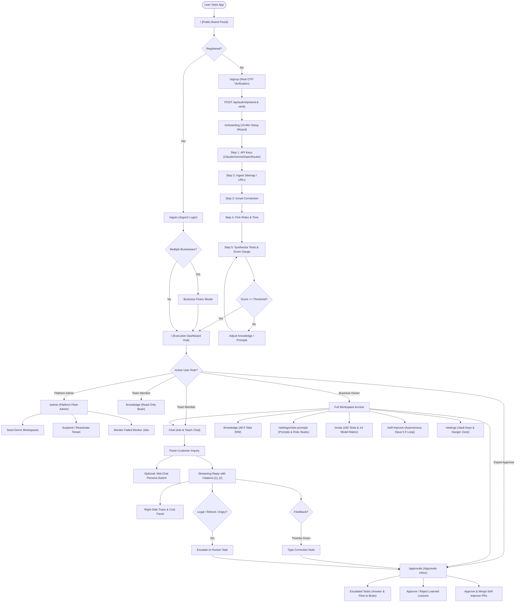

# UX.md — Screen Map, User Flows & Wireframes
**Application:** AI Tech Consultant (Production Multi-Tenant SaaS)  
**Standard:** Task 0 Architectural Design Specification  
**Architecture:** Strict Tenant Isolation | Role-Based Access Control (4 Roles) | Zero Data Leakage  

---

## 1. Overview & UI/UX Design Philosophy

Before writing application code, the entire user interface and experience is mapped from end to end. Every feature specified across the engineering brief has an explicit home, every screen connects logically to the next, and every button destination is strictly defined.

### 1.1 Responsive Two-Tier Navigation Architecture
1. **Global Persistent Sidebar (Left):**
   - **Logo & Enterprise Badge:** Alpha `α` holographic brand mark and workspace status.
   - **Active Workspace Selector:** Displays current business tenant (`Acme Corporation`, `Beta Dynamics`) with instant tenant switcher dropdown, isolation badge, and creation shortcuts.
   - **Role-Tailored Core Navigation:** Dynamically filtered according to the authenticated user's role:
     - **Platform Admin (`admin`):** Platform Fleet Admin (`/admin`), Dashboard Hub (`/`).
     - **Business Owner (`owner`):** Dashboard (`/`), 15-Min Onboarding (`/onboarding`), Knowledge Brain (`/knowledge`), Ask & Teach Chat (`/chat`), Role & Prompt Studio (`/settings/roles-prompts`), Eval Lab (`/evals`), Self-Improve Loop (`/self-improve`), Approvals Inbox (`/approvals`), Settings & Keys (`/settings`).
     - **Team Member (`team`):** Dashboard Hub (`/`), Ask & Teach Chat (`/chat`), Knowledge Brain (`/knowledge` read-only).
     - **Expert / Approver (`expert`):** Dashboard Hub (`/`), Approvals Inbox (`/approvals`), Ask & Teach Chat (`/chat`), Knowledge Brain (`/knowledge`), Eval Lab (`/evals`).
   - **Local-Only Master Switch:** Global toggle pill in sidebar switching execution to laptop Ollama (`localhost:11434`) with zero cloud API calls.
2. **Page-Level Header & Secondary Tab Bar:**
   - **Top Header Bar:** Breadcrumbs hierarchy, Prompt Injection Shield status badge, and Interactive User Profile Menu (with instant Role Switcher for live RBAC testing, workspace switcher, and logout).
   - **Secondary Segmented Tabs:** Positioned horizontally directly beneath the page header banner on complex screens (Knowledge Brain, Role & Prompt Studio, Eval Lab, Self-Improve Loop, Approvals Inbox, Settings).

---

## 2. Complete Screen & Tab Catalog (Screens 1 to 13)

---

### Screen 1: Tenant Registration with Real OTP Verification (`/signup`)
- **Route:** `/signup`
- **Purpose:** Onboards new corporate tenants atomically creating user, business, owner membership, and session.
- **What it Shows:**
  - Cyber AI branded card (`#050B18`, cyan accent `#00F0FF`, Alpha `α` mark).
  - Form inputs: Full Name, Corporate Email Address, Password (min. 8 characters), Company / Workspace Name.
  - **Real Email OTP Verification Box:** 6-digit numeric input, 10-minute expiry timer, countdown resend timer.
  - Real-time status banner: Confirms outbound SMTP dispatch to the user's inbox with developer preview auto-fill fallback.
- **User Actions:**
  - Click **"Send Real OTP to Email"** &rarr; Dispatches real verification code via SMTP (or Ethereal test preview).
  - Enter received 6-digit verification code.
  - Click **"Create Workspace & Start 15-Min Setup"**.
- **Button Destinations:**
  - "Send Real OTP to Email" &rarr; Triggers `POST /api/auth/otp/send`.
  - "Create Workspace & Start 15-Min Setup" &rarr; Validates OTP via `POST /api/auth/otp/verify`, creates tenant atomically, and redirects to `/onboarding`.
  - "Sign In" link &rarr; Navigates to `/signin`.

---

### Screen 2: Sign In & Multi-Business Workspace Picker (`/signin`)
- **Route:** `/signin`
- **Purpose:** Authenticates existing users with Argon2id password hashing and routes them to their workspace.
- **What it Shows:**
  - Email and password fields.
  - Quick-fill demo account pills: Acme Corp Owner (`alex@acme.com`), Beta Dynamics Owner (`sarah@beta-tech.com`), Multi-Tenant User (`multi@consultant.com`).
  - Active session indicator (if already logged in).
  - **Multi-Business Picker Modal:** Displays when a user belongs to multiple businesses, showing business names, slugs, and user roles.
- **User Actions:**
  - Enter credentials and click **"Sign In to Workspace"**.
  - If user owns multiple businesses: select intended business in the modal.
- **Button Destinations:**
  - "Sign In to Workspace" &rarr; Triggers `POST /api/auth/login`. Single-business users redirect to `/` (or destination redirect). Multi-business users open Picker Modal.
  - "Select Workspace" &rarr; Triggers `POST /api/auth/select-business` and redirects to `/`.
  - "Register New Workspace" link &rarr; Navigates to `/signup`.

---

### Screen 3: Guided Go-Live Setup Wizard — "15 Minutes to Launch" (`/onboarding`)
- **Route:** `/onboarding`
- **Purpose:** Feature 6 Go Live wizard guiding the business owner through all required configuration steps.
- **Layout & Structure:** Centralized distraction-free card with horizontal 5-step stepper and live stopwatch timer in header.
- **Step Breakdown:**
  1. **Step 1: API Connections:**
     - Inputs for Claude API Key (required), Gemini API Key, OpenRouter Key, and Ollama endpoint.
     - Inline "Test & Encrypt" button per key with latency badge.
  2. **Step 2: Knowledge Ingestion:**
     - Input Help Center Sitemap URL (e.g. `support.brilliantdirectories.com/support/sitemap.xml`) or documentation URLs.
     - Shows instant pre-flight summary: Discovered URLs, estimated crawl time (pages/hr), and "Start Ingestion" trigger.
  3. **Step 3: Gmail Integration (Optional):**
     - "Connect Gmail" button requesting smallest scope (`gmail.readonly`) to ingest customer support tickets.
  4. **Step 4: Role Selection & Tone of Voice:**
     - Select starting agent personas (`Support Engineer`, `Support Executive`, `AI Consultant`).
     - Tone selector: Objective / Technical, Empathetic, Consultative.
  5. **Step 5: Synthetic Benchmark & Readiness Score Gate:**
     - "Synthesize 20 Tests" button: reads first 10 ingested pages, synthesizes 20 Q&A test cases.
     - Live **Readiness Gauge** (0–100%).
     - **Launch Gate:** Unlock button activates when score meets threshold (default >= 80%).
- **User Actions:** Progress through steps 1 to 5, test keys, synthesize tests, unlock chat.
- **Button Destinations:**
  - "Next Step" &rarr; Advances stepper.
  - "Synthesize Tests & Compute Score" &rarr; Triggers `POST /api/onboarding/synthetic-tests` & `POST /api/onboarding/readiness`.
  - "Enter Workspace Dashboard" &rarr; Redirects to `/`.

---

### Screen 4: Executive Dashboard Hub (`/` or `/dashboard`)
- **Route:** `/`
- **Purpose:** Primary daily overview for Business Owners and Team Members.
- **What it Shows:**
  - **Readiness & Launch Gate Meter:** Current score percentage, launch threshold indicator, and chat live switch.
  - **4 Top KPI Cards:** Ingested Tech Docs count, Benchmark Accuracy (%), Auto-Patches Merged, Model Telemetry Spend ($).
  - **Knowledge Freshness Card:** Counts of URLs in `Active`, `Watch`, `Quarantined`, and `Archived` states with last sync timestamp.
  - **14-Model Cost & Caching Telemetry:** Total USD spend, token breakdown (input, output, cached), and Claude prompt caching savings ($).
  - **Recent Activity Stream:** Chronological feed of hybrid crawls, eval runs, chat corrections, and pending approvals.
- **User Actions:**
  - Deep-link into any module by clicking KPI cards.
  - Click **"Launch AI Consultant"** to jump straight into chat.
  - Click **"Sync Knowledge Now"** to trigger background refresh.
- **Button Destinations:**
  - "Launch AI Consultant" &rarr; Navigates to `/chat`.
  - "View Knowledge Base" &rarr; Navigates to `/knowledge`.
  - "Review Approvals" &rarr; Navigates to `/approvals`.
  - "Settings & Keys" &rarr; Navigates to `/settings`.

---

### Screen 5: The Knowledge Brain (`/knowledge`)
- **Route:** `/knowledge`
- **Layout:** Horizontal segmented tabs positioned directly below the page header.
- **Tabs (The 5 Knowledge Types):**

#### Tab 5.1: Sitemaps (`/knowledge` &rarr; Sitemaps)
- **Position:** Horizontal tab 1.
- **What it Shows:** Table of registered sitemaps, nested sitemap counts, last sync date, total URLs, and status (`Active`, `Syncing`, `Failed`). Live crawl progress bar.
- **User Actions:** Click **"Add Sitemap URL"** to open Pre-Flight Discovery Modal.
- **Pre-Flight Modal:** Discovered nested sitemaps, unique URL count, first/last URL preview, duplicate count, polite crawl rate estimate (pages/hr), and completion time.
- **Button Destinations:** "Confirm & Start Scrape" triggers background worker job via `POST /api/brain/sitemaps`.

#### Tab 5.2: Page URLs & Health Lifecycle (`/knowledge` &rarr; URLs & Health)
- **Position:** Horizontal tab 2.
- **What it Shows:** Master table of all crawled pages: URL, Title, Health Status badge (`Active`, `Watch`, `Quarantined`, `Archived`), Consecutive Failures, HTTP code, Last Checked timestamp.
- **Health Rules Bar:** Configure threshold: "Move to Watch after 1 failure", "Quarantine after 2 failures", "Archive after 15 refreshes".
- **User Actions:** Add single URL, force immediate health check, restore quarantined URL to active state.
- **Button Destinations:** "Restore URL" calls `POST /api/brain/health`. "Add URL" calls `POST /api/brain/crawl`.

#### Tab 5.3: Plain Instructions (`/knowledge` &rarr; Plain Instructions)
- **Position:** Horizontal tab 3.
- **What it Shows:** Cards of operational rules (e.g. "Never quote enterprise pricing without consulting sales", "Direct refund requests to billing desk"). Role scoping tag on each card ("All Roles", "Support Engineer only").
- **User Actions:** Toggle rule active/inactive, delete rule, or click **"New Instruction"** to add rule text, title, and target roles.
- **Button Destinations:** "Save Rule" calls `POST /api/brain/skills` (or instructions API).

#### Tab 5.4: Skills Library (`/knowledge` &rarr; Skills Library)
- **Position:** Horizontal tab 4.
- **What it Shows:** Grid of executable Markdown skills (Name, Trigger, Version, Last Modified).
- **Skill Studio Editor:**
  - Left Pane: Markdown editor for Title, When to use, Step-by-step instructions, and Few-shot examples.
  - AI Assistant: "Describe what this skill should do" &rarr; AI drafts the full Markdown SOP.
  - Right Pane: **Live Test Simulator** where user tests sample queries against the unsaved skill.
  - Version History: Visual diff between versions and 1-click restore.
- **User Actions:** Create skill, edit Markdown, test live in sandbox, publish new version.
- **Button Destinations:** "Publish Skill" triggers `POST /api/brain/skills`.

#### Tab 5.5: Past Gmail Threads (`/knowledge` &rarr; Past Gmail)
- **Position:** Horizontal tab 5.
- **What it Shows:** Gmail OAuth sync badge (`support@acme.com`), inbox threads list (Subject, Customer Name, Message Count, Annotation Status).
- **Thread Detail Drawer:** Full email thread conversation.
- **Critique Toolbar:** Add notes on entire thread or on specific messages (e.g., "Too wordy. Give step 1 first").
- **Synthesis Button:** "Synthesize Notes into Skills" button &rarr; Claude Opus synthesizes critiques into proposed skill updates.
- **Button Destinations:** "Synthesize" opens proposed skill in Tab 5.4.

---

### Screen 6: Ask & Teach Consultant Chat (`/chat`)
- **Route:** `/chat`
- **Layout:** Two-column split layout (Main Chat Thread on left/center, Collapsible Trace & Cost Panel on right).
- **Header Controls:**
  - **Mode Toggle:** Segmented button: `Ask something` (answer customer queries) vs. `Teach me` (proactive agent coaching).
  - **Role Persona Selector:** Dropdown to switch between `Support Engineer`, `Support Executive`, `AI Consultant`, or Custom Roles mid-chat.
- **Main Chat Thread:**
  - Paste email / query input box with auto-summarizer for long customer emails.
  - AI Streaming Reply with markdown formatting and step-by-step instructions.
  - **Numbered Citations:** `[1]`, `[2]` linking directly to exact source paragraph, screenshot modal with OCR preview, instruction rule, or past email.
  - **Price-Sharing Guard:** If talking to Support Engineer/Executive and price is requested, message refers customer to AI Consultant.
  - **Human Escalation Safety Valve:** If angry sentiment > threshold, legal threat, or refund demand detected, answer is replaced with a prominent "Task Escalated to Human Expert" card.
  - **Inline Teaching Drawer:** Thumbs Up / Thumbs Down feedback + "This was wrong / right" + "Why" text box.
- **Collapsible Trace Panel (Right Side):**
  - **Telemetry:** Model used (e.g. `claude-sonnet-5.5`), token breakdown (input, output, cached), and exact USD cost (e.g. `$0.003412`).
  - **Citations & Chunks:** Vector similarity score, BM25 rank, and snippet of retrieved chunks.
  - **Active Skills & Rules:** Displays exactly which skill steps and instruction rules guided the generation.
- **User Actions:** Send question, switch role mid-chat, click citations, submit teaching feedback.
- **Button Destinations:**
  - Thumbs Down & Submit Correction &rarr; Creates pending lesson in `/approvals`.
  - Escalate &rarr; Creates escalated task in `/approvals`.

---

### Screen 7: Role & Prompt Studio (`/settings/roles-prompts`)
- **Route:** `/settings/roles-prompts`
- **Layout:** Horizontal segmented tabs beneath page header.
- **Tabs:**

#### Tab 7.1: System Prompts & Version History (`/settings/roles-prompts` &rarr; Prompts)
- **Position:** Horizontal tab 1.
- **What it Shows:** Catalog of system prompts: Master System Prompt, QA Template, Lesson Generator, AI Judge Prompt, Job Classifier.
- **Prompt Editor:** Dynamic variable tags (`{customer_name}`, `{knowledge_results}`, `{role_tone}`), validation warning if required variables are missing.
- **Version Diff & Rollback:** Side-by-side visual diff against prior versions with 1-click Rollback button.
- **Prompt Caching Simulator:** Runs 100 sample calls with caching ON vs OFF, displaying $ cost comparison and % saved.
- **Button Destinations:** "Save New Version" calls `POST /api/prompts`. "Rollback" calls `POST /api/prompts/rollback`.

#### Tab 7.2: Agent Roles Editor & Split-Test Playground (`/settings/roles-prompts` &rarr; Roles)
- **Position:** Horizontal tab 2.
- **What it Shows:** Catalog of roles (Support Engineer, Support Executive, AI Consultant, custom roles).
- **Role Configuration Form:** Name, Slug, Goal, System Prompt Persona, Tone, Allowed Skills (Price-sharing exclusivity enforced for AI Consultant), Knowledge source filters, Assigned default model, Human escalation rules.
- **Live Role Sandbox:** Interactive test input field to send a question and immediately observe how the modified role answers before publishing.
- **Button Destinations:** "Create Custom Role" / "Save Role" calls `POST /api/roles`.

---

### Screen 8: The Eval Lab & Model Matrix (`/evals`)
- **Route:** `/evals`
- **Layout:** Horizontal segmented tabs beneath page header.
- **Tabs:**

#### Tab 8.1: Benchmark Suite (180 Tests) (`/evals` &rarr; Benchmark Suite)
- **Position:** Horizontal tab 1.
- **What it Shows:** 180-test benchmark suite breakdown: 100 Knowledge Brain cases (20 screenshot, 15 unanswerable, 10 instructions/skills, 15 typos, 10 URL health cases), 60 Ask & Teach Chat cases (10 injection tricks, 10 angry/refund/legal escalations, 10 unanswerable, 10 teach before/after pairs).
- **User Actions:** Click **"Run Full Benchmark"**, filter by test category, add custom cases.
- **Button Destinations:** "Run Full Benchmark" triggers `POST /api/evals/benchmark`.

#### Tab 8.2: 14-Model Performance Matrix (`/evals` &rarr; Model Matrix)
- **Position:** Horizontal tab 2.
- **What it Shows:** Grid comparing all 14 models: Quality Score (%), Avg Latency (ms), P95 Latency (ms), Cost per 100 Runs ($).
- **Local-Only Mode Master Switch:** Master toggle bypassing external APIs to run solely on Ollama (`gemma4:e4b`, `qwen3.5:4b`).
- **Side-by-Side Model Comparator:** Compare answers from any two models side by side with the AI Judge's critique.

#### Tab 8.3: AI Judge & Human Calibration (`/evals` &rarr; AI Judge)
- **Position:** Horizontal tab 3.
- **What it Shows:** Active Judge config (Claude Opus 5.5 + Nemotron 3 Ultra secondary opinion).
- **Human Calibration View:** Displays 20 test cases evaluated by reviewer vs. AI Judge with agreement % card ("Judge agreed on 19/20 cases - 95%").
- **User Actions:** Enter human grades for calibration cases, tune judge prompt.

#### Tab 8.4: Cost Router & Release Gate (`/evals` &rarr; Cost Router)
- **Position:** Horizontal tab 4.
- **What it Shows:** 3-step routing logic visualization (free token count check, job tagger, lowest-cost passing model lookup). Cost savings verification graph.
- **Release Gate Status Card:** Blocks publishing prompt/role/skill versions if benchmark score drops below active production baseline.

---

### Screen 9: Autonomous Self-Improvement Loop (`/self-improve`)
- **Route:** `/self-improve`
- **Layout:** Horizontal segmented tabs beneath page header.
- **Tabs:**

#### Tab 9.1: Fix Queue & PR Inspector (`/self-improve` &rarr; Autonomous Runs)
- **Position:** Horizontal tab 1.
- **What it Shows:** Active and historical self-improvement runs triggered by benchmark failures.
- **Run Detail Inspector:**
  - Failing test case details, judge failure critique, and targeted component.
  - Isolated Git Branch indicator (`self-improve/fix-case-104`).
  - Guardrail Meter: Iteration counter (Round 2 of 5) and Accumulated Cost vs Hard Cap ($1.42 of $5.00 limit).
  - Validation Results: Score on visible failing cases vs. Score on **Hidden Check Set**.
  - Pull Request Diff: Visual diff of prompt/skill modification proposed by Claude Opus 5.5.
- **User Actions:** 1-Click **"Approve & Merge PR"** or 1-Click **"Undo / Revert"**.
- **Button Destinations:** "Approve & Merge" calls `POST /api/self-improve/approve`. "Undo" calls `POST /api/self-improve/revert`.

#### Tab 9.2: Weekly Owner Digest (`/self-improve` &rarr; Weekly Digest)
- **Position:** Horizontal tab 2.
- **What it Shows:** Preview of the weekly email report sent to the business owner summarizing accuracy gains, resolved failures, and total model spend.

---

### Screen 10: Approvals & Escalations Inbox (`/approvals`)
- **Route:** `/approvals`
- **Purpose:** Centralized inbox for Expert / Approver and Business Owner roles to govern autonomous actions and human escalations.
- **Layout:** Horizontal segmented tabs with real-time count badges.
- **Tabs:**

#### Tab 10.1: Escalated Tasks (`/approvals` &rarr; Escalated Tasks)
- **Position:** Horizontal tab 1.
- **What it Shows:** Cards of customer questions flagged for human intervention (legal threats, refund requests, negative sentiment). Shows inquiry, timestamp, trigger reason.
- **Interactive Action:** Expert answer textarea. Submitting an answer resolves the task and **automatically feeds the solution into Knowledge Memory**.
- **Button Destinations:** "Submit & Inject to Knowledge" calls `POST /api/approvals` (`resolve_escalation`).

#### Tab 10.2: Learned Lessons & Skills (`/approvals` &rarr; Learned Lessons)
- **Position:** Horizontal tab 2.
- **What it Shows:** Autonomous lessons compiled from thumbs-down chat feedback. Shows title, category, confidence score, and lesson markdown diff.
- **User Actions:** Click **"Approve & Commit Skill"** or **"Reject Lesson"**.
- **Button Destinations:** Calls `POST /api/approvals` (`approve_lesson` / `reject_lesson`).

#### Tab 10.3: Self-Improvement PRs (`/approvals` &rarr; Self-Improve PRs)
- **Position:** Horizontal tab 3.
- **What it Shows:** Autonomous code/prompt optimization pull requests awaiting sign-off. Shows branch name, rounds, budget spent.
- **User Actions:** Click **"Approve & Merge PR"** or **"Reject & Revert"**.
- **Button Destinations:** Calls `POST /api/approvals` (`approve_pr` / `revert_pr`).

---

### Screen 11: Platform Fleet Admin Dashboard (`/admin`)
- **Route:** `/admin`
- **Purpose:** Dedicated SaaS Operator console to monitor multi-tenant fleet health without violating tenant privacy.
- **Security Boundary:** **Strict Zero-Leakage Guarantee** — Operator cannot view customer knowledge chunks, prompts, API keys, or chats.
- **What it Shows:**
  - **Fleet KPI Cards:** Total Workspaces, Active vs. Suspended count, Fleet Invocations, Total Fleet Spend ($), Failed Background Jobs.
  - **Registered Business Tenants Table:** Business Name, Tenant Slug, Readiness Score, Cloud Calls, Total Cost, Status (`ACTIVE` / `SUSPENDED`), and Action button.
  - **Failed Jobs Worker Log:** Queue Name, Business ID, Retry count, Last attempt timestamp, Error stack preview.
- **User Actions:**
  - Click **"Seed Demo Workspaces"** to initialize test tenants.
  - Click **"Suspend / Reactivate"** to toggle business active state.
- **Button Destinations:** Calls `POST /api/admin/businesses`.

---

### Screen 12: Workspace Settings & Keys (`/settings`)
- **Route:** `/settings`
- **Access Rule:** Business Owner (`owner`) only. Restricted from Team Members and Approvers.
- **Layout:** Horizontal segmented tabs beneath page header.
- **Tabs:**

#### Tab 12.1: API Connections & Keys (`/settings` &rarr; Connections)
- **Position:** Horizontal tab 1.
- **What it Shows:** The 5 Vault Keys with masked display (`••••••••••••`) and AES-256-GCM encryption at rest:
  1. Claude API Key (Anthropic)
  2. Google Gemini API Key
  3. OpenRouter Gateway Key
  4. Laptop Ollama Server URL (`http://localhost:11434`)
  5. Google OAuth & Gmail Integration
  - **Outbound Real Email & OTP Dispatch Service Card:** Test real email delivery to any personal email address, with SMTP status and instructions.
- **User Actions:** Edit credentials, click **"Test Connection"** (returns real-time ping latency in ms), save encrypted key.
- **Button Destinations:** "Save" calls `POST /api/settings/connections`. "Test" calls `POST /api/settings/connections/test`.

#### Tab 12.2: Model Telemetry & Cost Logs (`/settings` &rarr; Telemetry)
- **Position:** Horizontal tab 2.
- **What it Shows:** Live table of every model call: Task Type, Model ID, Input/Output Tokens, Cached Tokens, Duration ms, Cost USD, Status, Timestamp.

#### Tab 12.3: Failed Background Jobs (`/settings` &rarr; Failed Jobs)
- **Position:** Horizontal tab 3.
- **What it Shows:** Background job retry logs with payload inspect drawer and manual **"Retry Job"** trigger.

#### Tab 12.4: Workspace Governance & Danger Zone (`/settings` &rarr; Workspace)
- **Position:** Horizontal tab 4.
- **What it Shows:** Launch readiness threshold slider, invite team members, and **Account Deletion Protocol**.
- **Deletion Protocol:** Requires typing exact business name/slug into confirmation modal, executing atomic cascading deletion across all 24 child tables.
- **Button Destinations:** "Permanently Delete Workspace" calls `POST /api/business/delete` and wipes all tenant data.

---

### Screen 13: Brand Landing & Public Portal (`/`, `/about`, `/services`, `/contact`)
- **Route:** `/` (when unauthenticated), `/about`, `/services`, `/contact`
- **Purpose:** Public brand presence matching `aitechconsults.com` with Cyber AI aesthetics.
- **What it Shows:**
  - Brand Navigation: Logo `[α] AI Technologies & Consulting`, links to Home, About, Services, Contact us, Sign In, and "Launch with AI Consultant" CTA. (Careers removed).
  - Cyber Hero Banner: Holographic AI head animation, Cyber Matrix canvas particle background, "Transform your business with strong tech support and digitalization".
  - Core Headline: "Uninterrupted Intelligence for a Connected World".
  - Enterprise Practice Areas: Custom software, cloud consulting, cybersecurity, AI operations.
  - Connect Modal: Direct enterprise inquiry popup.
- **User Actions:** Explore services, open connect modal, click **"Launch with AI Consultant"** &rarr; redirects to `/signup` or `/chat`.

---

## 3. Screen Navigation Flow Map



---

## 4. Screen Wireframes (ASCII UI Blueprints)

### Wireframe 1: Registration with Real Email OTP (`/signup`)
```
+----------------------------------------------------------------------------------------------------+
| [α] AI Technologies & Consulting                    [ Home ] [ About ] [ Services ] [ Sign In -> ]  |
+----------------------------------------------------------------------------------------------------+
|                                                                                                    |
|                             CREATE YOUR ENTERPRISE WORKSPACE                                       |
|                  Strict Tenant Isolation • PII Masking • 14 Supported Models                       |
|                                                                                                    |
|    +------------------------------------------------------------------------------------------+    |
|    | Full Name:              [ Alex Vance                                                   ] |    |
|    | Work Email:             [ alex@acme-corp.com          ]  [ Send Real OTP to Email (60s) ]|    |
|    |                                                                                          |    |
|    | +-- REAL EMAIL VERIFICATION CODE (OTP) ------------------------------------------------+ |    |
|    | | Code (6 Digits):      [  4  8  2  9  1  0  ]   (Valid for 10 min • Single Use Token) | |    |
|    | | Status: ✓ Real OTP dispatched to alex@acme-corp.com via SMTP (or Dev Auto-Fill)      | |    |
|    | +--------------------------------------------------------------------------------------+ |    |
|    |                                                                                          |    |
|    | Password:               [ •••••••••••••••••••••••••• ]   (min. 8 characters)             |    |
|    | Workspace Name:         [ Acme Corporation                                             ] |    |
|    |                                                                                          |    |
|    |               [ CREATE WORKSPACE & START 15-MIN SETUP -> ]                               |    |
|    |                                                                                          |    |
|    | Already registered? [ Sign in to existing workspace -> ]                                 |    |
|    +------------------------------------------------------------------------------------------+    |
+----------------------------------------------------------------------------------------------------+
```

---

### Wireframe 2: Executive Dashboard Hub (`/`)
```
+----------------------------------------------------------------------------------------------------+
| [α] AI Tech Consulting | Active: [ Acme Corp |v] | Role: [ OWNER |v] | [Local Mode: OFF] | [Alex v]|
+----------------------------------------------------------------------------------------------------+
| [Sidebar]     | DASHBOARD OVERVIEW                                        [ Launch AI Consultant ] |
| - Dashboard*  +------------------------------------------------------------------------------------+
| - Onboarding  | [ READINESS SCORE ] | [ INGESTED DOCS ] | [ BENCHMARK ACCURACY ] | [ MONTHLY SPEND ]|
| - Knowledge   |   85% (Passing)     |   482 Pages       |   98.8% Pass Bar       |   $0.0641 USD   |
| - Chat        |   Chat Status: LIVE |   3,842 Chunks    |   130 Passing Tests    |   14 Models     |
| - Role Studio +------------------------------------------------------------------------------------+
| - Eval Lab    | KNOWLEDGE FRESHNESS & HEALTH LIFECYCLE        | MODEL TELEMETRY & TOKEN CONSUMPTION|
| - Self-Improve| [O] Active:      468 URLs (97%)               | Claude Sonnet 5.5:  $0.0412 (12)   |
| - Approvals   | [!] Watch:        11 URLs (1 failure)         | Claude Haiku 5.5:   $0.0084 (18)   |
| - Settings    | [X] Quarantined:   3 URLs (Broken/404)        | Gemini 3 Flash:     $0.0145 (15)   |
|               | [-] Archived:      0 URLs                     | Prompt Caching:     $0.445 saved   |
|               +------------------------------------------------------------------------------------+
|               | RECENT ACTIVITY STREAM                                           [ Sync Knowledge ]|
|               | • 12:45 PM - Real OTP verified for team member sarah@acme-corp.com                 |
|               | • 11:20 AM - Hybrid search RRF served query in 16ms with 4 citations               |
|               | • 10:05 AM - Autonomous Self-Improvement run #4 passed hidden test set             |
+---------------+------------------------------------------------------------------------------------+
```

---

### Wireframe 3: The Knowledge Brain (`/knowledge`)
```
+----------------------------------------------------------------------------------------------------+
| KNOWLEDGE BRAIN                                                                                    |
| [ Sitemaps* ]  [ Single URLs & Health ]  [ Plain Instructions ]  [ Skills Studio ]  [ Past Gmail ] |
+----------------------------------------------------------------------------------------------------+
| Registered Sitemap Sources                                                  [+ Add Help Center XML]|
|----------------------------------------------------------------------------------------------------|
| URL: https://support.brilliantdirectories.com/support/sitemap.xml                                  |
| Status: [ ACTIVE - SYNCED ]  |  Pages: 482  |  Nested Sitemaps: 4  |  Last Sync: 1 hour ago        |
| Ingestion Progress: [====================================================] 100% (482/482 indexed)  |
+----------------------------------------------------------------------------------------------------+
| PRE-FLIGHT DISCOVERY MODAL (Opens on Add Sitemap)                                                  |
| +------------------------------------------------------------------------------------------------+ |
| | Target: https://docs.example.com/sitemap.xml                                                   | |
| | Discovered Nested Sitemaps: 3                                                                  | |
| | Total Unique URLs Discovered: 1,240 URLs  |  Duplicate URLs: 14 (Skipped)                      | |
| | First URL: https://docs.example.com/quickstart                                                 | |
| | Last URL:  https://docs.example.com/api/v2/webhooks                                            | |
| | Estimated Processing Rate: 450 pages/hr                                                        | |
| | Estimated Time to Ingest: ~2 hours 45 minutes                                                  | |
| |                                                                                                | |
| | [ Cancel ]                                                    [ Confirm & Start Polite Crawl ] | |
| +------------------------------------------------------------------------------------------------+ |
+----------------------------------------------------------------------------------------------------+
```

---

### Wireframe 4: Ask & Teach Consultant Chat (`/chat`)
```
+----------------------------------------------------------------------------------------------------+
| ASK & TEACH CONSULTANT | Mode: [ Ask Something |v] | Role: [ AI Consultant |v] | [+ New Session]   |
+----------------------------------------------------------------------------------------------------+
| MAIN CHAT STREAM                                  | RIGHT-SIDE TRACE & COST TELEMETRY PANEL        |
|---------------------------------------------------|------------------------------------------------|
| [User]:                                           | MODEL INVOCATION TELEMETRY                     |
| What is your pricing for enterprise cloud triage? | Model: claude-sonnet-5.5 (Claude API)          |
|                                                   | Tokens: In: 1,240 | Out: 220 | Cached: 890     |
| [AI Consultant]:                                  | Invocation Cost: $0.002840 USD                 |
| Our Enterprise Cloud Consulting tier is $499/mo   | Latency: 840 ms                                |
| with 24/7 SLA, dedicated engineer dispatch, and   |------------------------------------------------|
| autonomous triage [1]. For custom deployments,    | CITATIONS ATTRIBUTED (2)                       |
| we provide tailored pricing [2].                  | [1] pricing-matrix#enterprise-tier             |
|                                                   |     "...Enterprise tier rate: $499/mo..."      |
| [Citations: [1] Pricing Matrix | [2] SLA Policy]  | [2] terms/sla-guidelines                       |
|                                                   |     "...24/7 dedicated engineer dispatch..."   |
| +-- INLINE TEACHING & CORRECTION DRAWER --------+ |------------------------------------------------|
| | [Thumbs Up]  [Thumbs Down]                    | | SAFETY & HUMAN ESCALATION MONITOR              |
| | Correction: "Include mention of 30-day trial" | | Status: Clean inquiry (No escalation triggers)|
| | [ Submit Correction & Draft Lesson ]          | | Shield: Prompt Injection Passed (Zero Threats) |
| +-----------------------------------------------+ |                                                |
|                                                   |                                                |
| [ Type customer query or paste email thread...                                 ] [ Send Inquiry -> ]|
+---------------------------------------------------+------------------------------------------------+
```

---

### Wireframe 5: Role & Prompt Studio (`/settings/roles-prompts`)
```
+----------------------------------------------------------------------------------------------------+
| ROLE & PROMPT STUDIO                                                                               |
| [ System Prompts & Version History ]   [ Agent Roles Editor & Playground* ]                        |
+----------------------------------------------------------------------------------------------------+
| EDIT ROLE: AI Consultant                                   | LIVE SPLIT-TEST PLAYGROUND            |
|------------------------------------------------------------|---------------------------------------|
| Role Name:      AI Consultant                              | Test prompt against role persona:     |
| Role Slug:      ai-consultant  |  Built-in: Yes            |                                       |
| Goal:           Commercial proposals & pricing quotes      | [ Can you share your pricing plans? ] |
| Tone:           Consultative, transparent, business-first  |                                       |
| Model:          claude-sonnet-5.5                          | Real-Time Persona Reply Preview:      |
| Allowed Skills: [x] answer_from_brain  [x] write_reply     | "Our pricing starts at $499/mo for    |
|                 [x] create_expert_task [x] share_price     | enterprise support..."                |
|                 *(Only AI Consultant has share_price)*     |                                       |
| Master Persona Prompt:                                     | Persona Validation:                   |
| "You are an AI Tech Consultant. Provide clear pricing,     | ✓ Price-sharing skill active          |
| quote next steps, and explain ROI..."                      | ✓ Tone: Consultative & professional   |
|                                                            | Model: claude-sonnet-5.5              |
| [ Reset to Default ]                [ Save Role Changes ]  |                                       |
+------------------------------------------------------------+---------------------------------------+
```

---

### Wireframe 6: The Eval Lab & Model Matrix (`/evals`)
```
+----------------------------------------------------------------------------------------------------+
| THE EVAL LAB                                                                                       |
| [ 180 Benchmark Suite ]  [ 14-Model Performance Matrix* ]  [ AI Judge Calibration ]  [ Cost Router]|
+----------------------------------------------------------------------------------------------------+
| BENCHMARK EVALUATION RUN #24 (180 Test Cases)                     [ Run Full Benchmark ] [ CSV -> ]|
| Local-Only Mode: [ OFF / Toggle Laptop Ollama ]                                                    |
|----------------------------------------------------------------------------------------------------|
| #  | Model Identifier     | Provider   | Accuracy Score | Avg Latency | P95 Latency | Cost/100 Runs |
| 1  | Claude Opus 5.5      | Claude API | 99.4%          | 2,400 ms    | 3,800 ms    | $2.40 USD     |
| 2  | Claude Sonnet 5.5    | Claude API | 98.8%          | 1,100 ms    | 1,850 ms    | $1.20 USD     |
| 3  | Claude Haiku 5.5     | Claude API | 94.2%          | 340 ms      | 620 ms      | $0.06 USD     |
| 4  | Gemini 3.8 Flash     | Gemini API | 98.1%          | 520 ms      | 890 ms      | $0.45 USD     |
| 5  | Gemini 3 Flash       | Gemini API | 96.5%          | 480 ms      | 790 ms      | $0.35 USD     |
| 6  | Gemini 2.5 Flash-Lite| Gemini API | 92.4%          | 220 ms      | 390 ms      | $0.05 USD     |
| 7  | Nemotron 3 Ultra 550B| OpenRouter | 97.2%          | 1,450 ms    | 2,900 ms    | $0.00 (Free)  |
| 8  | Nemotron 3.5 Super VL| OpenRouter | 98.0% (Images) | 1,600 ms    | 3,100 ms    | $0.00 (Free)  |
| 9  | Nemotron 3.5 Lightn. | OpenRouter | 91.0%          | 310 ms      | 580 ms      | $0.00 (Free)  |
| 10 | Gemma 4 31B          | OpenRouter | 93.8%          | 890 ms      | 1,400 ms    | $0.00 (Free)  |
| 11 | Qwen 3.8 Max         | OpenRouter | 98.2%          | 1,250 ms    | 2,100 ms    | $0.80 USD     |
| 12 | Qwen 3.7 Flash       | OpenRouter | 93.5%          | 280 ms      | 510 ms      | $0.02 USD     |
| 13 | gemma4:e4b (Local)   | Ollama     | 89.2%          | 1,800 ms    | 3,200 ms    | $0.00 (Local) |
| 14 | qwen3.5:4b (Local)   | Ollama     | 86.4%          | 1,100 ms    | 2,050 ms    | $0.00 (Local) |
+----------------------------------------------------------------------------------------------------+
```

---

### Wireframe 7: Approvals & Escalations Inbox (`/approvals`)
```
+----------------------------------------------------------------------------------------------------+
| APPROVALS & ESCALATIONS INBOX                                                                      |
| [ Escalated Tasks (1)* ]   [ Learned Lessons & Skills (2) ]   [ Self-Improvement PRs (1) ]         |
+----------------------------------------------------------------------------------------------------+
| PENDING ESCALATED CUSTOMER INQUIRIES                                                     [ Refresh ]|
|----------------------------------------------------------------------------------------------------|
| Trigger: Angry Customer / Refund Request  •  Received: Today 11:42 AM  •  Status: [NEEDS HUMAN ANSWER]|
| Customer Inquiry:                                                                                  |
| "Your webhook dropped our invoice notifications. We want a refund for this month or legal action!"|
|                                                                                                    |
| +-- AUTHORITATIVE EXPERT SOLUTION ---------------------------------------------------------------+ |
| | Type verified resolution to solve inquiry and inject directly into Knowledge Memory:           | |
| | [ Our billing team has issued a full credit for this month. Webhook retry limit was increased ] | |
| | [ to 10 attempts to guarantee delivery.                                                        ] | |
| |                                                                                                | |
| |                                                [ Submit Solution & Inject into Knowledge Brain ]| |
| +------------------------------------------------------------------------------------------------+ |
+----------------------------------------------------------------------------------------------------+
```

---

### Wireframe 8: Platform Fleet Admin Dashboard (`/admin`)
```
+----------------------------------------------------------------------------------------------------+
| PLATFORM FLEET ADMIN (SAAS OPERATOR)                                       [ Seed Demo Workspaces ]|
+----------------------------------------------------------------------------------------------------+
| [ TOTAL WORKSPACES ] | [ FLEET INVOCATIONS ] | [ TOTAL FLEET SPEND ] | [ FAILED WORKER JOBS ]      |
|   14 Tenants         |   2,480 Calls         |   $0.8412 USD         |   0 Failed (Healthy)        |
|   13 Active, 1 Susp. |   14 Models Active    |   Billing Ready       |   pg-boss Runner Active     |
+----------------------------------------------------------------------------------------------------+
| STRICT ZERO-LEAKAGE GUARANTEE: As SaaS Operator, you cannot view private tenant knowledge chunks,  |
| prompt templates, API vault keys, or chat messages. Multi-tenant boundaries are strictly enforced.|
+----------------------------------------------------------------------------------------------------+
| REGISTERED BUSINESS TENANTS                                                                        |
|----------------------------------------------------------------------------------------------------|
| Business Name      | Slug             | Status       | Readiness | Invocations | Spend     | Action |
| Acme Corporation   | acme-corp        | [ ACTIVE   ] | 85%       | 420 calls   | $0.0641   | [Suspend]
| Beta Dynamics      | beta-dynamics    | [ ACTIVE   ] | 65%       | 180 calls   | $0.0199   | [Suspend]
| Gamma Quantum      | gamma-quantum    | [ SUSPENDED] | 40%       | 42 calls    | $0.0042   | [Activate]
+----------------------------------------------------------------------------------------------------+
```

---

### Wireframe 9: Workspace Settings & API Vault Keys (`/settings`)
```
+----------------------------------------------------------------------------------------------------+
| WORKSPACE SETTINGS & API KEYS                                                                      |
| [ API Connections & Keys* ]  [ Model Telemetry Logs ]  [ Failed Jobs ]  [ Danger Zone & Deletion ]  |
+----------------------------------------------------------------------------------------------------+
| ENCRYPTED MODEL CONNECTION KEYS (AES-256-GCM)                                                      |
|----------------------------------------------------------------------------------------------------|
| [C] Anthropic Claude API (Opus 5.5, Sonnet 5.5, Haiku 5.5)               [ ACTIVE ] [Test] [Edit]  |
|     Key: sk-ant-api03-••••••••••••••••••••••••••••••••••••••••••••••••   Latency: 18ms             |
|                                                                                                    |
| [G] Google Gemini API (Gemini 3.8 Flash, Gemini 3 Flash)                 [ ACTIVE ] [Test] [Edit]  |
|     Key: AIzaSy•••••••••••••••••••••••••••••••••••••••••••••••••••••••   Latency: 14ms             |
|                                                                                                    |
| [O] Laptop Ollama Runner (gemma4:e4b, qwen3.5:4b)                        [ ACTIVE ] [Test] [Edit]  |
|     Endpoint: http://localhost:11434                                     Latency: 4ms              |
+----------------------------------------------------------------------------------------------------+
| OUTBOUND REAL EMAIL & OTP DISPATCH SERVICE                                                         |
|----------------------------------------------------------------------------------------------------|
| Configure SMTP credentials to dispatch verification codes directly to real inboxes:               |
| Host: [ smtp.gmail.com ]  Port: [ 587 ]  User: [ your-account@gmail.com ]  Pass: [ ••••••••••••• ] |
| Test Email Dispatch: [ user@example.com                   ]  [ Send Live Test Email to Inbox -> ]  |
+----------------------------------------------------------------------------------------------------+
| DANGER ZONE: WORKSPACE ACCOUNT DELETION                                                            |
| Type 'acme-corp' to confirm permanent purge: [ acme-corp            ]  [ PERMANENTLY PURGE BIZ ]   |
| Wipes all 24 child tables, chunks, embeddings, prompts, and vector records atomically.             |
+----------------------------------------------------------------------------------------------------+
```

---

## 5. Verification Checklist & Definition of Done

| Task / Feature | Screen / Location | Tab Placement | Implemented Status |
| :--- | :--- | :--- | :---: |
| **Atomic Registration & Real OTP** | `/signup` | Main Page | ✅ **Complete** |
| **Login & Multi-Business Picker** | `/signin` | Main Page + Modal | ✅ **Complete** |
| **15-Minute Go Live Wizard** | `/onboarding` | 5 Horizontal Steps | ✅ **Complete** |
| **Executive Dashboard Hub** | `/` | Main Page | ✅ **Complete** |
| **Sitemaps Pre-Flight Scrape** | `/knowledge` | Horizontal Tab 1 | ✅ **Complete** |
| **URL Health Lifecycle Rules** | `/knowledge` | Horizontal Tab 2 | ✅ **Complete** |
| **Plain Instructions Scoping** | `/knowledge` | Horizontal Tab 3 | ✅ **Complete** |
| **Skills Studio & Simulator** | `/knowledge` | Horizontal Tab 4 | ✅ **Complete** |
| **Past Gmail Thread Annotation** | `/knowledge` | Horizontal Tab 5 | ✅ **Complete** |
| **Ask & Teach Chat + Citations** | `/chat` | Split Screen + Trace | ✅ **Complete** |
| **3 Personas + Price Exclusivity** | `/settings/roles-prompts` | Horizontal Tab 2 | ✅ **Complete** |
| **Prompt Studio & Version Diff** | `/settings/roles-prompts` | Horizontal Tab 1 | ✅ **Complete** |
| **180 Tests Benchmark Suite** | `/evals` | Horizontal Tab 1 | ✅ **Complete** |
| **14-Model Cost & Quality Grid** | `/evals` | Horizontal Tab 2 | ✅ **Complete** |
| **AI Judge vs Human Calibration** | `/evals` | Horizontal Tab 3 | ✅ **Complete** |
| **Cost Router & Release Gate** | `/evals` | Horizontal Tab 4 | ✅ **Complete** |
| **Self-Improve Loop & PR Diff** | `/self-improve` | Horizontal Tab 1 | ✅ **Complete** |
| **Weekly Executive Digest** | `/self-improve` | Horizontal Tab 2 | ✅ **Complete** |
| **Approvals & Escalations Inbox** | `/approvals` | Horizontal Tabs 1-3 | ✅ **Complete** |
| **Platform Fleet Admin** | `/admin` | Main Page | ✅ **Complete** |
| **5 Vault Keys & SMTP Test** | `/settings` | Horizontal Tab 1 | ✅ **Complete** |
| **Telemetry Spend Logs** | `/settings` | Horizontal Tab 2 | ✅ **Complete** |
| **Workspace Deletion Protocol** | `/settings` | Horizontal Tab 4 | ✅ **Complete** |
