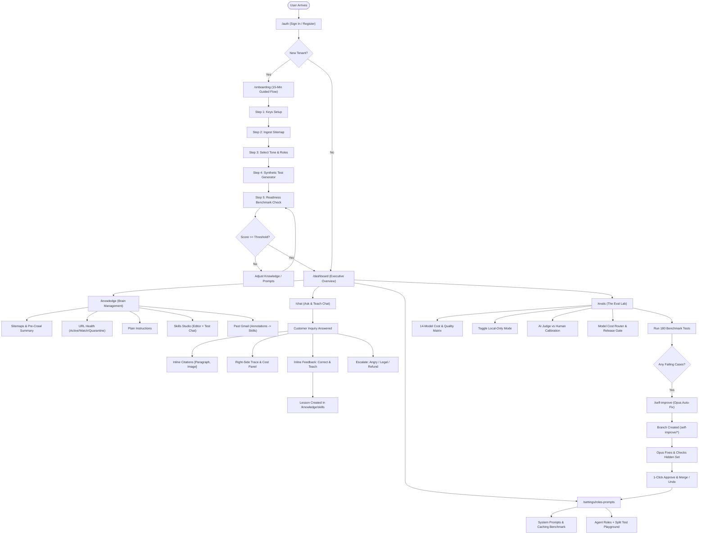

# UX.md — Screen Map, User Flows & Wireframes

**Application:** AI Tech Consultant (Multi-Tenant SaaS)  
**Standard:** Task 0 Architectural Design (Step 0–2 Deliverable)  
**Author:** Principal Full-Stack Software Architect & UI/UX Engineer  

---

## 1. Global Navigation & Layout Architecture

The application utilizes a responsive, two-tier navigation structure:
1. **Global Persistent Sidebar (Left):**
   - **Workspace Selector:** Displays active Business name and switcher dropdown (`/auth/switch`).
   - **Core Navigation Links:**
     - 📊 **Dashboard** (`/dashboard`)
     - 🧠 **Knowledge Brain** (`/knowledge`)
     - 💬 **Ask & Teach Chat** (`/chat`)
     - 🎭 **Roles & Prompts** (`/settings/roles-prompts`)
     - 🧪 **Eval Lab** (`/evals`)
     - 🔄 **Self-Improve Loop** (`/self-improve`)
     - ⚙️ **Settings & Keys** (`/settings`)
   - **User Profile & Status Footer:** Authenticated user badge, "Local-Only" toggle pill, and logout.
2. **Page-Level Header & Secondary Tab Bar:**
   - Top banner displays active breadcrumb, real-time sync status, and quick-action buttons.
   - For multi-faceted screens (Knowledge, Roles & Prompts, Evals, Settings), horizontal segmented tabs sit directly below the header.

---

## 2. Comprehensive Screen & Tab Breakdown

### Screen 1: Authentication & Workspace Onboarding (`/auth`)
- **Route:** `/auth/signin`, `/auth/signup`
- **Sub-views:** Sign In with Email/Password, Sign Up, Google OAuth 2.0 button.
- **What it shows:**
  - Modern authentication card with brand identity.
  - Fields: Email, Password, Business Name (on sign-up), and "Sign In with Google" option.
  - Test demo credential quick-fill pills (`demo@business-a.com`, `demo@business-b.com`).
- **User Actions:**
  - Sign in or register a new business tenant.
  - Automatically initializes session cookie with `business_id` scoping.
- **Button Destinations:**
  - "Create Workspace" -> Redirects to `/onboarding` for new businesses.
  - "Sign In" -> Redirects to `/dashboard` for existing businesses.

---

### Screen 2: Guided Onboarding — "Go Live in 15 Minutes" (`/onboarding`)
- **Route:** `/onboarding`
- **Layout:** Centralized distraction-free 5-step horizontal stepper with a live **Stopwatch Timer** in the header.
- **Step 1: Credentials Setup:**
  - Input Claude API Key, Gemini Key, and OpenRouter Key with inline "Validate" status badges.
- **Step 2: Knowledge Ingestion:**
  - Input Help Center Sitemap URL (prefilled with `support.brilliantdirectories.com/support/sitemap.xml`) or single URLs.
  - Shows instant pre-flight summary: Discovered URLs, Estimated scrape time (pages/hr), and "Start Ingestion" trigger.
- **Step 3: Role & Voice Configuration:**
  - Choose starting agent role (Support Engineer, Support Executive, AI Consultant) and select company tone.
- **Step 4: Synthetic Benchmark Generation:**
  - One-click trigger: AI reads first 10 ingested pages and synthesizes 20 domain-specific Q&A test cases automatically.
- **Step 5: Readiness Score & Launch Gate:**
  - Runs instant evaluation against the 20 synthesized test cases.
  - Displays dynamic **Readiness Gauge** (e.g., "85/100 readiness - Meets Launch Criteria").
  - Unlocks "Enter Consultant Workspace" button when score exceeds chosen threshold (default >= 80%).

---

### Screen 3: Executive Dashboard (`/dashboard`)
- **Route:** `/dashboard`
- **What it shows:**
  - **KPI Metric Banners:** Total Ingested Pages, Active Chunks, Monthly LLM Cost ($), Average Query Latency (ms), Benchmark Accuracy (%), Open Human Tasks.
  - **Model Spend & Token Breakdown:** Interactive bar chart tracking spend across the 14 models and prompt caching savings ($ saved).
  - **Knowledge Freshness Card:** Counts of URLs in `Active`, `Watch`, `Quarantined`, and `Archived` states.
  - **Recent Activity Feed:** Real-time log of background crawls, eval runs, and teaching lessons submitted.
- **User Actions:**
  - Click any KPI card to deep-link into the respective module.
  - Trigger instant "Sync Knowledge" or "Run Fast Eval".

---

### Screen 4: The Knowledge Brain (`/knowledge`)
- **Route:** `/knowledge`
- **Secondary Tabs (5 Knowledge Types):**

#### Tab 4.1: Sitemaps (`/knowledge/sitemaps`)
- **What it shows:**
  - Table of registered sitemap sources, nested sitemap counts, last sync date, total URLs, and status (`Active`, `Syncing`, `Failed`).
  - "Add Sitemap" modal with real-time pre-flight analysis: counts total nested sitemaps, total URLs, first/last URL, duplicate URLs detected, and estimated processing time (pages/hr).
  - Live crawl progress bar displaying processed pages, embedded chunks, and time remaining.
- **User Actions:** Add sitemap, trigger immediate re-crawl, view crawl logs.

#### Tab 4.2: Page URLs & Health Lifecycle (`/knowledge/urls`)
- **What it shows:**
  - Master URL table with columns: URL, Title, Health Status badge (`Active`, `Watch`, `Quarantined`, `Archived`), Consecutive Failures, HTTP Code, Last Checked.
  - Health policy settings bar: "Move to Watch on 1 failure", "Quarantine after X failures" (default 2), "Archive after Y refreshes" (default 15).
  - "Refresh Run View" slide-out drawer: Shows fetch timestamps, total URLs scanned, response code distribution, and full audit list.
- **User Actions:** Add single URL, manually force health check, restore quarantined URL to active, inspect archived version.

#### Tab 4.3: Plain Instructions (`/knowledge/instructions`)
- **What it shows:**
  - Cards listing active operational rules (e.g., "Never promise refunds. Direct all billing questions to billing@company.com").
  - Role scoping badge on each card: "All Roles" or specific roles (e.g., "Support Engineer only").
  - Quick toggle switch (Active / Inactive) and delete button.
- **User Actions:** Click "New Instruction" to open modal; specify rule text, title, and target roles.

#### Tab 4.4: Skills Library (`/knowledge/skills`)
- **What it shows:**
  - Grid of executable Markdown skills (e.g., "Domain Setup & DNS Configuration", "Billing Downgrades").
  - Each skill card displays: Skill Name, Trigger Conditions, Version Number, and Last Modified Date.
  - **Skill Studio Editor:**
    - Left Pane: Markdown editor for Name, Trigger, Step-by-Step Instructions, and Few-Shot Examples.
    - AI Drafting Tool: "Describe what this skill should do" -> AI generates the full Markdown guide.
    - Right Pane: **Live Test Simulator** where user tests sample user prompts against the unsaved skill to verify behavior in real time.
    - Version History Dropdown: View diffs between versions and 1-click restore older versions.
- **User Actions:** Create skill, edit Markdown, test live, publish new version.

#### Tab 4.5: Past Gmail Threads (`/knowledge/emails`)
- **What it shows:**
  - Gmail sync status badge ("Connected to support@business.com via Google OAuth").
  - Inbox thread list showing Customer Subject, Last Message Date, Message Count, and Status (`Annotated`, `Pending`).
  - Thread Detail View: Expands full email conversation history.
  - Annotation Toolbar: Add critique note on entire thread or on specific message (e.g., "Too wordy. Give step 1 first").
  - "Synthesize Notes into Skills" button: Invokes Claude Opus 5.5 to synthesize notes into draft skill updates.
- **User Actions:** Sync new threads, annotate messages, review and approve AI-generated skill drafts.

---

### Screen 5: Ask & Teach Chat (`/chat`)
- **Route:** `/chat`
- **Layout:** Two-column split-screen layout (Main Chat Thread on left/center, Collapsible Trace & Citation Panel on right).
- **Header Controls:**
  - **Mode Toggle:** `Ask something` (Customer query answering) vs. `Teach me` (Proactive agent training).
  - **Role Selector:** Dropdown to switch between Support Engineer, Support Executive, AI Consultant, or Custom Roles mid-session.
  - **Human Escalation Indicator:** Highlights if current query triggered human handoff.
- **Chat Stream Elements:**
  - **Pasted Email Summarizer:** Automatically collapses long pasted emails into identified core inquiry.
  - **Assistant Message:** Streaming response with formatted markdown, step-by-step instructions, and code blocks.
  - **Interactive Citations:** Numbered badges `[1]`, `[2]` linking directly to exact source paragraph, screenshot modal, instruction rule, skill, or past email.
  - **Safety / Human Escalation Card:** If query matches angry customer sentiment, legal threats ("lawyer", "sue"), or refund demands, replaces normal answer with a prominent "Ticket Created for Human Expert" action card.
  - **Inline Teaching Drawer:** Thumbs Up / Thumbs Down buttons + expander "This was wrong / right" + "Why" text box for immediate on-the-fly corrections.
- **Collapsible Trace Panel (Right Side):**
  - **Model & Routing:** Model used (e.g., `claude-sonnet-5.5`), routing tier, and token breakdown (input, output, cached).
  - **Cost Telemetry:** Exact call cost displayed in USD (e.g., `$0.003412`).
  - **Retrieved Chunks:** Displays vector similarity score, BM25 rank, and snippet of used knowledge chunks.
  - **Active Skills & Rules:** Displays exactly which skill steps and instruction rules guided the generation.

---

### Screen 6: Role & Prompt Studio (`/settings/roles-prompts`)
- **Route:** `/settings/roles-prompts`
- **Secondary Tabs:**

#### Tab 6.1: Prompts & System Templates (`/settings/roles-prompts/prompts`)
- **What it shows:**
  - List of core system prompts: Master System Prompt, QA Template, Lesson Generator, AI Judge Prompt, Job Classifier.
  - Prompt Editor with dynamic variable highlighter (`{customer_name}`, `{knowledge_results}`, `{role_tone}`).
  - Validation Warning Banner: Alerts user before saving if required variables are omitted.
  - Version Diff Viewer: Side-by-side visual diff against previous versions with 1-click restore.
  - Prompt Caching Cost Simulator: Runs 100 sample calls with caching ON vs. OFF, displaying $ cost comparison and % saved.

#### Tab 6.2: Agent Roles Editor (`/settings/roles-prompts/roles`)
- **What it shows:**
  - Role Catalog: Support Engineer, Support Executive, AI Consultant, + user-created custom roles.
  - Role Configuration Form: Role Name, Slug, Goal, System Prompt Persona, Tone Slider, Allowed Skills Multi-select, Knowledge Source Filters, Assigned Default Model, Human Escalation Triggers.
  - **Side-by-side Role Test Chat:** Real-time test input field to send a question and immediately observe how the modified role answers before publishing.
- **User Actions:** Edit pre-built roles, create custom roles, test live, publish changes.

---

### Screen 7: The Eval Lab (`/evals`)
- **Route:** `/evals`
- **Secondary Tabs:**

#### Tab 7.1: Benchmark Suite (180 Tests) (`/evals/benchmark`)
- **What it shows:**
  - Benchmark test catalog: 100 Knowledge Brain cases (20 screenshot, 15 unanswerable, 10 instructions/skills, 15 synonyms/typos, 10 URL health cases), 60 Ask & Teach Chat cases (10 prompt injection tricks, 10 angry/refund/legal escalations, 10 unanswerable, 10 teach before/after pairs).
  - "Run Benchmark" action bar with model multi-select and batch runner progress bar.
- **User Actions:** Run full benchmark, filter by test category, add custom test cases.

#### Tab 7.2: 14-Model Comparison Matrix (`/evals/models`)
- **What it shows:**
  - Grid comparing all 14 models: Quality Score (%), Average Latency (ms), P95 Latency (ms), and Cost per 100 Runs ($).
  - **Local-Only Mode Toggle:** Master switch to disable all external APIs and run solely on `gemma4:e4b` and `qwen3.5:4b` on Ollama (`localhost:11434`), displaying quality drop delta.
  - Side-by-Side Model Comparator: Compare answers from any two models (e.g., Claude Sonnet 5.5 vs. Qwen 3.8 Max) on the same question, with the AI Judge's score and critique.

#### Tab 7.3: AI Judge & Human Calibration (`/evals/judge`)
- **What it shows:**
  - Active Judge Configuration: Default Claude Opus 5.5 + Nemotron 3 Ultra secondary opinion.
  - Human Review Calibration View: Displays 20 test cases evaluated by the candidate/reviewer vs. the AI Judge.
  - Calibration metric card: "Judge agreed on 18/20 cases (90%)".
- **User Actions:** Enter human grades for calibration cases, tune judge prompt.

#### Tab 7.4: Cost Router & Release Gate (`/evals/router`)
- **What it shows:**
  - 3-Step Router Visualization: (1) Free token count / 100k cap check, (2) Fast job tagger, (3) Lowest-cost passing model lookup.
  - Cost Savings Verification Graph: Proves router achieves equal quality score to Sonnet 5.5 at lower total expenditure.
  - **Release Gate Status Card:** Enforces blocking rule—prevents publishing prompt/role/skill versions if benchmark score drops below the active version.
  - Ingested Chat Feedback: Table of thumbs up/down feedback converted into new regression tests.

---

### Screen 8: Self-Improve Loop (`/self-improve`)
- **Route:** `/self-improve`
- **What it shows:**
  - Execution Queue: Active and past self-improvement runs triggered by Eval Lab failures.
  - **Run Detail Inspector:**
    - Failing test case details, judge failure critique, and targeted prompt/code component.
    - Git Branch Indicator: Displays isolated branch (`self-improve/fix-case-104`).
    - Guardrail Meter: Iteration count (e.g., Round 2 of 5) and Accumulated Cost vs. Hard Cap (e.g., $1.42 of $5.00 limit).
    - Validation Results: Score on visible failing cases vs. Score on **Hidden Check Set**.
    - Pull Request Diff: Visual diff of prompt/skill modification proposed by Claude Opus 5.5.
  - **Action Controls:** 1-Click "Approve & Merge" button, 1-Click "Undo / Revert" button.
  - **Weekly Owner Digest Tab:** Formatted preview of the weekly report sent to the business owner summarizing accuracy gains, resolved failures, and monthly cost.

---

### Screen 9: Workspace Settings & Integrations (`/settings`)
- **Route:** `/settings`
- **Sub-views:**
  - **API Connections (The 5 Vault Keys):**
    1. Claude API Key (Anthropic)
    2. Gemini API Key (Google AI Studio)
    3. OpenRouter API Key
    4. Local Ollama Server URL (`http://localhost:11434`)
    5. Google OAuth Account (Gmail Read-Only)
  - Masked key display with AES-256 encryption at rest and "Test Connection" ping button.
  - **Team Management:** Invite team members and manage roles (Owner, Admin, Support Agent).
  - **Danger Zone:** Business Account Deletion button with two-step confirmation (purges all records, embeddings, and files permanently).

---

## 3. Screen Navigation Flow Map



---

## 4. Screen Wireframes (ASCII / UI Blueprints)

### Wireframe 1: Executive Dashboard (`/dashboard`)
```
+----------------------------------------------------------------------------------------------------+
| AI TECH CONSULTANT  |  Workspace: Acme Corp [v]  |  [Local-Only: OFF]  |  User: alex@acme.com      |
+----------------------------------------------------------------------------------------------------+
| [Sidebar]     |  DASHBOARD OVERVIEW                                            [Run Fast Eval] [+] |
| - Dashboard*  +------------------------------------------------------------------------------------+
| - Knowledge   | [ Total Ingested ] | [ Active Chunks ] | [ Monthly Spend ] | [ Benchmark Pass ]    |
| - Chat        |   482 Pages        |   3,842 Chunks    |   $14.28 USD      |   98.4% (Passing)     |
| - Roles&Prompts+------------------------------------------------------------------------------------+
| - Eval Lab    | MODEL COST & TOKEN CONSUMPTION (LAST 30 DAYS)     | URL HEALTH DISTRIBUTION        |
| - Self-Improve| $8 |                                              |  [O] Active:      468 pages    |
| - Settings    | $4 |       -- [Sonnet]                            |  [!] Watch:        10 pages    |
|               | $2 |   --  -- [Haiku]                             |  [X] Quarantined:   3 pages    |
|               | $0 +-------------------------                     |  [-] Archived:      1 pages    |
|               |    Prompt Caching Savings: $21.40 saved (62%)     |                                |
|               +------------------------------------------------------------------------------------+
|               | RECENT ACTIVITY STREAM                                                             |
|               | * 10:14 AM - Hybrid crawl completed for support.acme.com (12 new chunks indexed)   |
|               | * 09:30 AM - Human correction approved: Lesson 'DNS A-Record Ordering' merged       |
|               | * 08:15 AM - Eval Run #42 completed across 14 models: Router beat Sonnet by 41% cost|
+---------------+------------------------------------------------------------------------------------+
```

### Wireframe 2: The Knowledge Brain — Sitemaps & Pre-Crawl Modal (`/knowledge/sitemaps`)
```
+----------------------------------------------------------------------------------------------------+
| KNOWLEDGE BRAIN                                                                                    |
| [ Sitemaps ]  [ Single URLs ]  [ Instructions ]  [ Skills Library ]  [ Past Gmail Threads ]        |
+----------------------------------------------------------------------------------------------------+
| Sitemaps Ingestion Sources                                                  [+ Add Sitemap URL]    |
|----------------------------------------------------------------------------------------------------|
| URL: https://support.brilliantdirectories.com/support/sitemap.xml                                  |
| Status: [SYNCED - ACTIVE]  |  Pages: 482  |  Nested Sitemaps: 4  |  Last Sync: 2 hrs ago           |
| Live Sync Progress: [========================================] 100% (482/482 pages indexed)        |
+----------------------------------------------------------------------------------------------------+
| PRE-FLIGHT READ SUMMARY MODAL (Triggered on Add Sitemap)                                           |
| +------------------------------------------------------------------------------------------------+ |
| | Target Sitemap: https://docs.example.com/sitemap.xml                                           | |
| | Discovered Nested Sitemaps: 3                                                                  | |
| | Total Unique URLs Discovered: 1,240 URLs  |  Duplicate URLs Detected: 18 (will skip)           | |
| | First URL: https://docs.example.com/intro                                                      | |
| | Last URL:  https://docs.example.com/troubleshooting/webhooks                                   | |
| | Estimated Processing Rate: 450 pages/hr                                                        | |
| | Estimated Completion Time: ~2 hours 45 minutes                                                 | |
| |                                                                                                | |
| | [ Cancel ]                                                  [ Confirm & Start Polite Scrape ]  | |
| +------------------------------------------------------------------------------------------------+ |
+----------------------------------------------------------------------------------------------------+
```

### Wireframe 3: Ask & Teach Chat with Split Trace Panel (`/chat`)
```
+----------------------------------------------------------------------------------------------------+
| CHAT CONSULTANT  |  Mode: [ Ask Something |v]  |  Role: [ Support Engineer |v]  |  [+ New Session] |
+----------------------------------------------------------------------------------------------------+
| MAIN CHAT STREAM                                  | RIGHT TRACE & CITATION PANEL                   |
|---------------------------------------------------|------------------------------------------------|
| [User]:                                           | INVOCATION TELEMETRY                           |
| How do I set up a custom domain with Cloudflare?  | Model: claude-sonnet-5.5 (Claude API)          |
|                                                   | Tokens: In: 1,420 | Out: 280 | Cached: 1,100   |
| [AI Assistant - Support Engineer]:                | Call Cost: $0.003420 USD                       |
| To configure a custom domain with Cloudflare:     | Latency: 980 ms                                |
| 1. In your Cloudflare DNS panel, create an        |------------------------------------------------|
|    'A' Record pointing @ to 54.214.12.8 [1].      | RETRIEVED CITATIONS (3)                        |
| 2. Set SSL/TLS encryption mode to Full [2].       | [1] support.acme.com/domain-setup#p4           |
| 3. Add your domain in the Settings tab [3].       |     "...point your root A record to 54..."     |
|                                                   | [2] Screenshot: Cloudflare SSL Config          |
| [Citations: [1] DNS Guide | [2] SSL Config Image] |     [View Image Modal] (Matched via OCR/VL)    |
|                                                   | [3] Skill: 'Custom Domain Standard Protocol'   |
| +-----------------------------------------------+ |------------------------------------------------|
| | INLINE TEACHING DRAWER                        | | ESCALATION MONITOR                             |
| | [Thumbs Up] [Thumbs Down]                     | | Status: Normal inquiry (No escalation)       |
| | Correction: "Step 1 is correct, but add CNAME | |                                                |
| |              instructions for www subdomains" | |                                                |
| | [Submit Correction & Generate Draft Lesson]   | |                                                |
| +-----------------------------------------------+ |                                                |
+---------------------------------------------------+------------------------------------------------+
```

### Wireframe 4: Role & Prompt Studio with Live Playground (`/settings/roles-prompts/roles`)
```
+----------------------------------------------------------------------------------------------------+
| ROLES & PROMPT STUDIO                                                                              |
| [ System Prompts & Diff ]  [ Agent Roles & Editor* ]                                               |
+----------------------------------------------------------------------------------------------------+
| EDIT ROLE: Support Engineer                                | LIVE ROLE PLAYGROUND (PREVIEW)        |
|------------------------------------------------------------|---------------------------------------|
| Role Name: Support Engineer                                | Type query to preview role response:  |
| Slug: support-engineer  |  Built-in: Yes                   |                                       |
| Goal: Provide code-level, step-by-step technical fixes.    | [ What happens if my webhook 500s?  ] |
| Tone: Objective, technical, precise, code-first.           |                                       |
| Assigned Model: claude-sonnet-5.5                          | Response Preview:                     |
| Allowed Skills: [x] DNS Setup [x] Webhook Debug [ ] Sales  | "When your webhook returns HTTP 500,  |
|                                                            | our queue triggers an exponential     |
| Master Persona Prompt:                                     | backoff retry for 5 attempts before   |
| "You are an expert Tier-3 Support Engineer. Always analyze | dead-lettering..."                    |
| root cause, provide diagnostic commands, and cite exact    |                                       |
| configuration lines."                                      | Depth: Technical                      |
|                                                            | Tone: Authoritative / Code-level      |
| [ Revert to Default ]                 [ Save Role Changes ]| Model: claude-sonnet-5.5 (Ready)      |
+------------------------------------------------------------+---------------------------------------+
```

### Wireframe 5: The Eval Lab — 14-Model Comparison Matrix (`/evals/models`)
```
+----------------------------------------------------------------------------------------------------+
| THE EVAL LAB                                                                                       |
| [ 180 Benchmark Suite ]  [ 14-Model Performance Matrix* ]  [ AI Judge Calibration ]  [ Cost Router]|
+----------------------------------------------------------------------------------------------------+
| EVALUATION RUN #18 (Full 180-Test Benchmark)                    [ Run Full Benchmark ] [ Export CSV|
| Local-Only Mode: [ OFF / Enable Local Ollama Only ]                                                |
|----------------------------------------------------------------------------------------------------|
| #  | Model Name           | Provider   | Quality Score | Avg Latency | P95 Latency | Cost/100 Runs |
| 1  | Claude Opus 5.5      | Claude API | 99.4%         | 2,400 ms    | 3,800 ms    | $2.40 USD     |
| 2  | Claude Sonnet 5.5    | Claude API | 98.8%         | 1,100 ms    | 1,850 ms    | $1.20 USD     |
| 3  | Claude Haiku 5.5     | Claude API | 94.2%         | 340 ms      | 620 ms      | $0.06 USD     |
| 4  | Gemini 3.8 Flash     | Gemini API | 98.1%         | 520 ms      | 890 ms      | $0.45 USD     |
| 5  | Gemini 3 Flash       | Gemini API | 96.5%         | 480 ms      | 790 ms      | $0.35 USD     |
| 6  | Gemini 2.5 Flash-Lite| Gemini API | 92.4%         | 220 ms      | 390 ms      | $0.05 USD     |
| 7  | Nemotron 3 Ultra 550B| OpenRouter | 97.2%         | 1,450 ms    | 2,900 ms    | $0.00 (Free)  |
| 8  | Nemotron 3.5 Super VL| OpenRouter | 98.0% (Images)| 1,600 ms    | 3,100 ms    | $0.00 (Free)  |
| 9  | Nemotron 3.5 Lightn. | OpenRouter | 91.0%         | 310 ms      | 580 ms      | $0.00 (Free)  |
| 10 | Gemma 4 31B          | OpenRouter | 93.8%         | 890 ms      | 1,400 ms    | $0.00 (Free)  |
| 11 | Qwen 3.8 Max         | OpenRouter | 98.2%         | 1,250 ms    | 2,100 ms    | $0.80 USD     |
| 12 | Qwen 3.7 Flash       | OpenRouter | 93.5%         | 280 ms      | 510 ms      | $0.02 USD     |
| 13 | gemma4:e4b (Local)   | Ollama     | 89.2%         | 1,800 ms    | 3,200 ms    | $0.00 (Local) |
| 14 | qwen3.5:4b (Local)   | Ollama     | 86.4%         | 1,100 ms    | 2,050 ms    | $0.00 (Local) |
+----------------------------------------------------------------------------------------------------+
```
